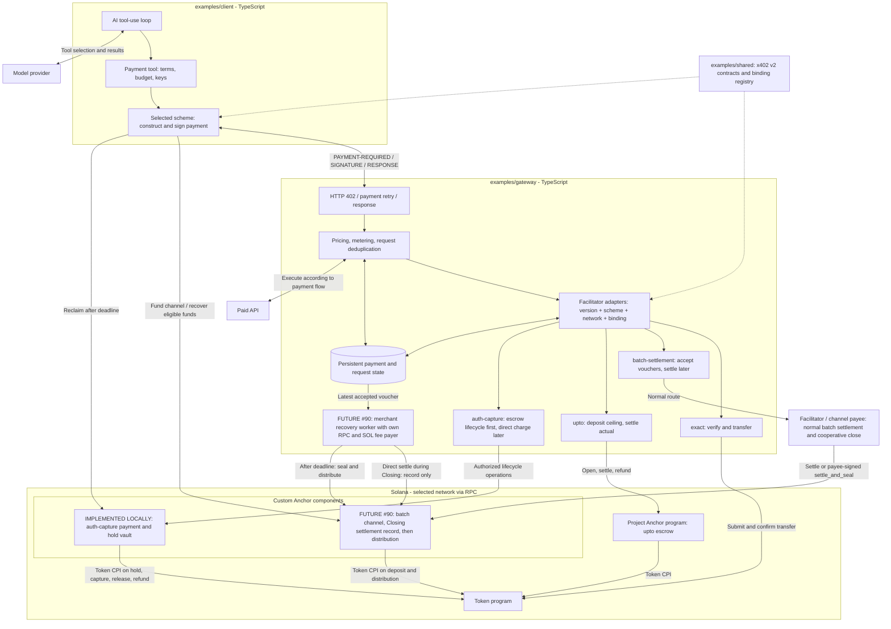
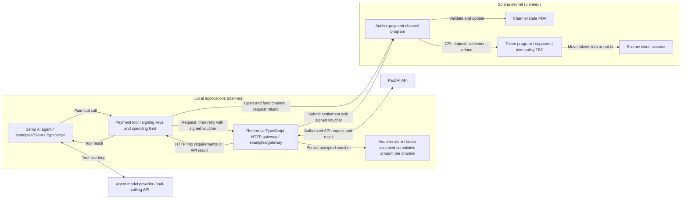
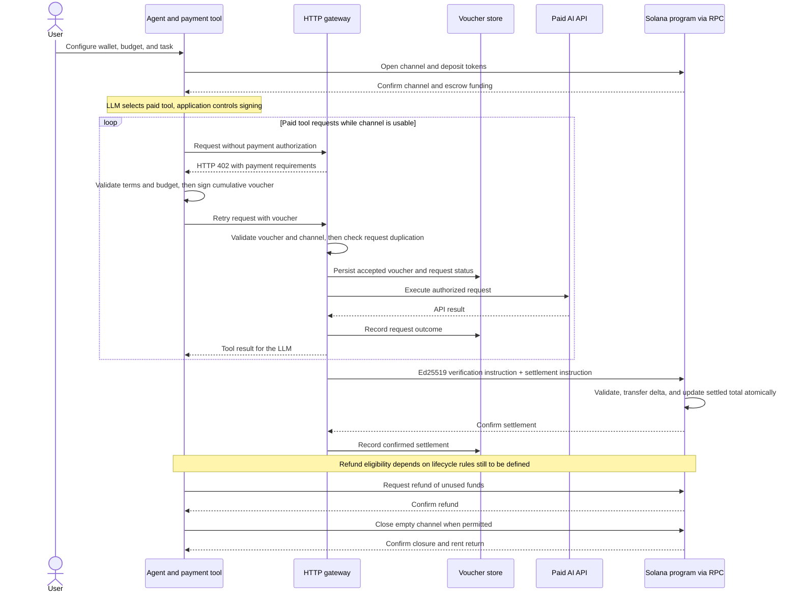
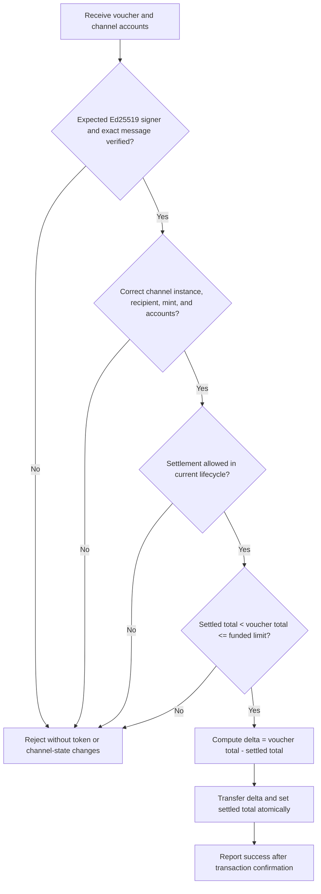
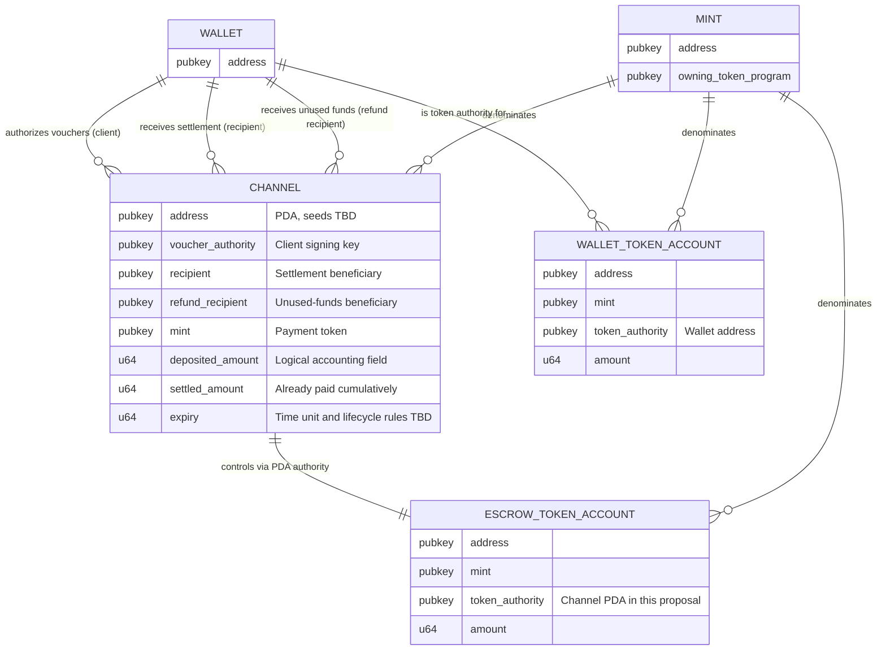

# Architecture

**Implementation update:** The Demo Day focus is the experimental [auth-capture escrow binding](topics/auth-capture/ARCHITECTURE.md) and [demo runbook](topics/auth-capture/demo.md). This repository's Anchor program implements hold, capture, release, refund, and payer reclaim with local LiteSVM tests. The browser agent, client, gateway, and facilitator completed the escrow path and a later merchant refund on a real local validator using a test token. Simulated-RPC HTTP tests provide separate coverage. The official `@x402/svm` batch route is also wired, while the custom Anchor batch diagrams below and Issue #90 Closing recovery remain proposals.

Architecture and account design for [x402-solana-demo](../README.md). The Anchor program implements single-request `upto` and experimental `auth-capture` escrow paths at the same program ID. `exact` uses a standard token transfer, while the official SDK batch route uses the Foundation payment-channels program. The [gateway paths and local facilitator](../examples/gateway/README.md) connect to the [payment client](../examples/client/README.md). The custom program is deployed on Devnet; live Devnet settlement remains unverified.

The architecture covers all four x402 schemes. The Demo Day presentation focuses on the locally tested [auth-capture escrow binding](topics/auth-capture/ARCHITECTURE.md). [Issue #90 Closing-period recovery](topics/closing-settlement/ARCHITECTURE.md) remains a separate batch design target; the four-scheme implementation scope remains in force.

## Purpose and scope

The project plans x402 on Solana across all four schemes. The TypeScript gateway and agent exercise the protocol; this repository's Anchor program backs `upto` and the experimental escrow-only `auth-capture` binding, while the running batch route uses the official Foundation channel program. An AI model selects tools; application code controls signing and spending. Merchant-operated recovery during Closing for batch-settlement (Issue #90) remains future work.

This document organizes the design around requirements, component boundaries, account relationships, and operations with explicit validation and state changes. It is a self-contained design proposal; instruction names, fields, and flows below are not a finalized API or claims of upstream compatibility.

| Requirement | Responsible component | Expected outcome |
| --- | --- | --- |
| Fund a channel for one mint and recipient | Payment tool + settlement program | Tokens enter escrow and channel state records the funding and payment identities. |
| Authorize repeated paid requests within a budget | Payment tool + gateway | Cumulative vouchers authorize payment without a transaction for every API request. |
| Provide an actual LLM tool-use demo | Agent + model provider + gateway | The agent chooses a paid tool and incorporates the returned result. |
| Settle only newly authorized funds | Settlement program | A valid voucher pays the difference from the amount already settled. |
| Return unused funds and release account rent | Settlement program | Refund and close succeed only under defined lifecycle and authority rules. |
| Explain and reject invalid operations | Gateway + settlement program | Invalid signatures, mismatched accounts, overspending, and invalid lifecycle transitions cannot withdraw funds. |

The initial target is a local TypeScript demo connected to Solana devnet. Public hosting, MCP integration, Token-2022 extension experiments, and separate funding/close/refund authorities are follow-up candidates. Staking, yield distribution, KYC, and credential issuance are outside this payment-channel demo.

### Shared paid demo resource

The payment paths share the fictional Donald Trump "insider information" parody from [`demo-resource.ts`](../examples/gateway/src/demo-resource.ts), with `fictional: true` and a disclaimer. `GET /api/trump-insider` uses `exact`; opt-in `/upto`, `/batch`, and `/auth-capture` routes use the corresponding schemes and the same response. The payment requirements and settlement adapter change between routes. The custom Anchor batch recovery remains planned. Neither the content nor the API claims real non-public information.

### Demo Day path: auth-capture escrow

The opt-in `/api/trump-insider/auth-capture` route advertises a project-specific `anchor-auth-capture-escrow-v1` binding. The payer signs `authorize_hold` for a 1000-unit ceiling and the facilitator confirms funding before the handler runs. After the handler, the merchant signs `capture_and_void_hold(300)`; the program pays 300 to the merchant and returns 700 to the payer in one transaction. Merchant-funded refunds and payer reclaim after the capture deadline use direct signed CLI operations. The payment PDA persists with fixed token accounts, deadlines, counters, and a monotonic operation sequence. The [focused architecture](topics/auth-capture/ARCHITECTURE.md) gives account constraints and trust boundaries; the [demo runbook](topics/auth-capture/demo.md) gives local evidence and live setup.

This path implements the generic scheme's escrow ordering in a custom binding. It does not implement the separate direct `authorization → charge` flow or the payment-channels Issue #90 Closing proposal. LiteSVM program tests, simulated-RPC HTTP tests, and the real local-validator payment and refund pass; live Devnet balances remain unverified. The local harness uses the SDK's Devnet CAIP routing identifier with a localhost RPC and test mint; it does not claim a Devnet transfer.

## Four-scheme implementation scope (planned)

The project will implement examples for all four x402 schemes: `exact`, `batch-settlement`, `upto`, and `auth-capture`. The `exact` HTTP example is locally tested through the repository facilitator and mock RPC; the `upto` HTTP flow is locally tested through its Anchor-backed facilitator and mock RPC, with program behavior tested separately in LiteSVM. The official SDK batch route has local challenge, forwarding, and storage tests; a full on-chain payout and live devnet settlement remain unverified. An experimental escrow-only `auth-capture` route has local HTTP and LiteSVM tests; direct charge and Devnet verification remain open. The official [core specification, section 6](https://github.com/x402-foundation/x402/blob/main/specs/x402-specification-v2.md#6-payment-schemes-the-logic) lists these schemes. The TypeScript examples pin SDK 2.28.0.

| Scheme | Planned implementation | Compatibility boundary and source |
| --- | --- | --- |
| `exact` | Agent signs a token transfer; the gateway's facilitator adapter validates, sponsors, submits, and confirms it. No custom channel is needed. | Target the official [SVM exact binding](https://github.com/x402-foundation/x402/blob/main/specs/schemes/exact/scheme_exact_svm.md). |
| `batch-settlement` | The opt-in HTTP route uses the official SVM SDK and canonical channel program for client-signed cumulative vouchers, durable acceptance, and later redemption. A separate Anchor channel and #90 recovery route are proposed. | The running route targets the [official SVM binding](https://github.com/x402-foundation/x402/blob/cb0ec5bca0a5b21860a36bb60f34433c2e8e0d71/specs/schemes/batch-settlement/scheme_batch_settlement_svm.md). The proposed Anchor binding would require its own program ID and wire format. |
| `upto` | Authorize and escrow a request ceiling in this repository's Anchor program, settle the actual charge, and refund the unused deposit. | The official [SVM upto binding](https://github.com/x402-foundation/x402/blob/main/specs/schemes/upto/scheme_upto_svm.md) fixes a different program ID and voucher format. The demo's Solana payload requires this repository's client and facilitator; it is not official SVM interoperable. |
| `auth-capture` | The opt-in custom Anchor escrow route implements hold, capture, void, refund, and payer reclaim with explicit authorities, deadlines, and operation sequences. Direct charge remains future work. | This is a project-specific Solana binding. The [generic specification](https://github.com/x402-foundation/x402/blob/main/specs/schemes/auth-capture/scheme_auth_capture.md) does not establish compatibility for this Anchor implementation. |

### Shared runtime and scheme boundaries

Use one TypeScript workspace with `examples/shared/` for HTTP contracts, scheme selection, and program-call helpers, alongside the gateway and agent. Anchor IDL remains the custom program interface; it does not specify the HTTP protocol. The application selects an adapter by protocol version, scheme, network, and explicitly configured binding. The demo's program binding must be explicit, and official SVM interoperability must not be claimed for a different program ID.

The implemented `exact`, `upto`, batch, and auth-capture HTTP paths use x402 v2 `PAYMENT-REQUIRED`, `PAYMENT-SIGNATURE`, and `PAYMENT-RESPONSE` as specified in the [HTTP transport specification](https://github.com/x402-foundation/x402/blob/main/specs/transports-v2/http.md). The payment client checks the recipient, asset, amount ceiling, network, and per-run budget before signing. In `upto`, the client signs a one-request channel open for the ceiling; the gateway merchant signs `settle` for the actual charge after the handler. In auth-capture, the client signs a hold and the merchant signs atomic capture/release after the handler. The SDK batch path signs cumulative vouchers and uses a periodic worker to claim and distribute. The LLM tool loop can select all four adapters. Batch channel, pending transaction, and client allocation state persist in local files; complete request outcome recovery remains planned.

The facilitator role can run with the gateway in the demo; it need not be a separate deployment. Its capability list must advertise only enabled and tested bindings. Respect the selected payment flow instead of forcing every adapter into one sequence: the [core specification, section 6.1](https://github.com/x402-foundation/x402/blob/main/specs/x402-specification-v2.md#61-asset-transfer-methods-and-payment-flow-models) distinguishes authorization, upfront, and escrow ordering. A stored batch commitment must not be reported as a confirmed token transfer.

Keep the batch voucher signing key separate from the escrow merchant key. Returning unused escrow is a different transfer from an auth-capture refund of already captured funds. The implemented refund uses merchant liquidity and consent, with an on-chain sequence and captured-funds limit; the facilitator is not a refund guarantor. These are binding requirements in the [auth-capture specification](https://github.com/x402-foundation/x402/blob/main/specs/schemes/auth-capture/scheme_auth_capture.md#network-requirements).

### Delivery order and acceptance criteria

All four are in scope. The `exact` example has a locally tested HTTP and facilitator flow. The `upto` HTTP path is opt-in; it targets this repository's Anchor program, whose lifecycle has LiteSVM coverage but still needs live Devnet testing. The official SDK batch route is opt-in; full on-chain payout remains unverified. The custom #90 Anchor experiment remains planned. The experimental `auth-capture` escrow route is opt-in, locally tested, and is the Demo Day focus.

1. **Shared transport + exact:** exercise 402, budget-controlled signing, payment verification, confirmed transfer, and paid response. Reject wrong mint/recipient/amount and unsafe sponsor transactions; reconcile retry and unknown transaction outcomes without a second charge.
2. **Batch settlement:** implement the Anchor channel and its documented binding. Execute multiple paid requests without per-request on-chain settlement; recover vouchers after restart; redeem only the authorized delta; test replay, concurrent requests, and settlement/refund races.
3. **Upto:** exercise maximum authorization, measured actual usage, and unused-balance return. Test zero usage, actual above maximum, expired authorization, duplicate request/channel, and abandoned-request recovery. Document the official SVM binding difference and verify the repository's deployed program independently.
4. **Auth capture:** specify the Solana binding and state machine, then test authorize, partial/repeated capture, void, direct charge, partial/repeated refund, and reclaim. Assert cumulative balance limits, server consent, deadlines, single-use operation IDs, refund liquidity failures, and recovery after restart.

Every milestone needs deterministic integration tests plus a documented runnable example. Share the LLM tool-use loop across schemes, but test payment correctness without depending on a model provider. Publish a per-binding support matrix with specification revision, network/program ID, SDK version, and test evidence before claiming interoperability.

## System overview (planned four-scheme architecture)

The overview includes all four schemes and distinguishes the implemented auth-capture escrow from the planned custom batch recovery. The auth-capture route is the presentation focus. The older batch-settlement detail diagrams below combine settlement and delta transfers. The [Issue #90 experiment](topics/closing-settlement/ARCHITECTURE.md) instead separates settlement recording from token distribution; its dedicated design governs that target.

The following diagrams describe the proposed demo in the [project notes](ideas.md#demo-scope-and-implementation-languages) and [gateway proposal](proposals/ai-gateway.md). They are design sketches, not implemented interfaces or a finalized upstream-compatible account schema. The initial deployment target is Solana devnet, with the agent and gateway running locally.

The gateway lives in `examples/gateway/` as a service-side reference implementation. The payment CLI and tool-using LLM agent live in `examples/client/`. Both are TypeScript. Repository Anchor program calls use shared `@solana/kit` helpers; `exact` token transfers use the x402 SVM SDK. The settlement program is independent of the examples and any AI provider.

This overview combines implemented and proposed components; it is not a transaction ordering diagram. The #90 Closing recovery experiment remains planned. The auth-capture path has LiteSVM and simulated-RPC tests; the separate official SDK batch route has local challenge and storage tests. Each request selects one enabled binding; it does not execute all four branches. The proposed #90 recovery worker is a separate merchant route with its own fee payer and RPC access so a facilitator outage can be tested. Its `settle` would record an authorized amount; token distribution would be a later operation. See the [#90 transaction routes](topics/closing-settlement/ARCHITECTURE.md#actors-and-transaction-routes) and [auth-capture lifecycle](topics/auth-capture/ARCHITECTURE.md#escrow-request-and-lifecycle-flow) for the focused flows. Shared modules contain code and contracts, not a shared key service. The implemented file stores retain batch vouchers and pending signatures; the proposed store would also track request outcomes and lifecycle IDs. `exact` follows the [official SVM exact](https://github.com/x402-foundation/x402/blob/main/specs/schemes/exact/scheme_exact_svm.md) binding. The local `upto` route targets this repository's Anchor program and is not interoperable with the fixed-program [official SVM upto](https://github.com/x402-foundation/x402/blob/main/specs/schemes/upto/scheme_upto_svm.md) binding. The planned custom batch branch is a project design; the implemented auth-capture account layout is documented separately.

### Batch-settlement component detail

This expands only the batch branch of the overview. Other schemes do not inherit its client-signed cumulative vouchers or long-lived channel.

### Component responsibilities and trust boundaries

| Component | Owns or stores | Responsibility / boundary |
| --- | --- | --- |
| Agent (`examples/client/`) | Conversation and tool results | Runs the LLM tool-use loop. Model output cannot bypass the payment tool's spending checks. |
| Payment tool (part of the agent example) | Client signing key, spending policy, payment references, issued authorizations | Validates requirements and uses the selected client adapter to sign transactions or vouchers. Performs client funding/recovery operations where applicable. Keys never enter prompts or tool results. |
| Shared contracts (`examples/shared/`) | Versioned payload definitions and binding configuration | Keeps client/server encoding and binding selection consistent; contains no runtime wallet custody. |
| Gateway (`examples/gateway/`) | API credentials, pricing/metering, request status | Returns payment requirements, coordinates the selected payment flow, and calls the paid API. |
| Facilitator adapters (initially gateway-hosted) | Transaction signer and scheme-specific verification/settlement logic | Validate authorization and execute the selected binding. Transaction sponsorship does not replace client authorization or required server consent. |
| Payment store (gateway-owned; technology TBD) | Authorizations, request outcomes, operation IDs, settlement progress | Supports deduplication and restart recovery across schemes; includes the batch branch's latest accepted cumulative voucher. This is off-chain storage, not a Solana account. |
| Anchor program | Implemented `upto` escrow and auth-capture hold state; planned custom batch state | Enforces signatures, accounting, and lifecycle rules. It does not call HTTP APIs or verify the quality of an AI answer. |
| Token program | Mint and token account data | Executes transfers authorized by the wallet or program PDA. The settlement program owns channel state, not token account data. |
| External providers and Solana RPC | Model/API responses; transaction submission and chain reads | Are external dependencies. RPC submission must be followed by confirmation or reconciliation before reporting settlement success. |

Custom program calls use the Anchor TypeScript client and Anchor IDL. HTTP messages and off-chain voucher encoding require their own shared contract; the program IDL alone does not define them. Keep program-call helpers separate from HTTP and model logic so a later client-library change is localized. Shared Rust crates are not the cross-language contract.

## Batch-settlement payment flow (planned)

The sequence below is the successful path. Setup uses a supported test mint and funded devnet wallets; neither the mint nor deployment tooling has been selected yet. Fees are paid in SOL, separately from the channel's payment token.

The loop illustrates the batch-settlement path and the 402 handshake, not a requirement to receive a new 402 for every request. Use the x402 v2 headers described above; binding-specific payloads, request identifiers, and retry rules still need to be specified. Voucher acceptance, API execution, and Solana settlement are separate operations and cannot form one atomic transaction. The operations, lifecycle, and account diagram below describe this channel path, not the state machines of all four schemes.

## Batch-settlement operations and validation (planned)

The names below are working names. “Caller” describes the demo flow, not a finalized permission rule. Instruction-specific signer, writable-account, and remaining-account lists will be fixed with the upstream baseline and channel schema.

| Operation | Caller and inputs | Validation before effect | State change and token movement |
| --- | --- | --- | --- |
| `open_channel` | Funding wallet; amount, mint, payment identities, expiry, fresh channel identity | Funding authority, supported mint/program, source account, valid terms, unique channel instance | Create channel state and escrow; transfer deposit from source; record usable deposited amount. Creation and funding should be atomic. |
| Paid HTTP request | Payment tool; API input, channel reference, signed cumulative voucher | Gateway checks signature, bound terms, available authorization, channel eligibility, and request duplication | Persist authorization and request status, then call the paid API. No on-chain mutation for the request itself. |
| `claim` (settlement) | Gateway submits voucher and signature-verification instruction | Program checks verified signer/message, channel and recipient binding, mint/accounts, lifecycle, and cumulative amount | Transfer only the authorized delta from escrow to recipient; update settled total in the same transaction. |
| `refund` | Authorized requester; channel, escrow, refund destination | Refund authority/beneficiary, lifecycle eligibility, destination mint, remaining refundable balance | Return unused tokens and record terminal/refunded state so later claims cannot spend refunded funds. |
| `close_channel` | Authorized closer; terminal channel and rent destination | Required settlement/refund complete, escrow empty, close authority, valid rent destination | Close eligible accounts and return rent. Closing state must not enable replay against a new channel. |

### Settlement decision flow

For this draft, duplicate or older cumulative amounts are rejected. A future baseline may instead define an equal-amount claim as a no-op, but it must never transfer funds twice. Example in token base units: a voucher authorizes 300 and 200 has already settled; the next successful settlement transfers 100.

### Accounting and lifecycle invariants

- For a baseline without transfer fees, settled total must never exceed the usable deposit. Settlement and refund together must never return more than the funded amount; unsolicited token transfers and dust need an explicit policy before closing is implemented.
- Escrow transfers and their corresponding accounting changes must succeed or fail together. Checked integer arithmetic and token base units are required; floating-point pricing must not enter on-chain accounting.
- Every voucher must be bound to an unambiguous channel instance and payment terms. The signed format must prevent reuse across programs, deployments, or reopened channels; its exact domain, identifiers, and encoding remain TBD.
- Refund must not invalidate a claim that is still eligible under the selected lifecycle rules. Settlement cutoff, refund eligibility, race ordering, and whether a grace period exists must be specified together.
- Conceptually the lifecycle is funded/active, then settlement completed or no longer eligible, then unused balance refunded, then accounts closed. These are design stages, not a proposed serialized enum. An exhausted channel may skip a zero-value refund if the final rules permit it.

### Failure and retry behavior

| Failure | Required behavior / unresolved policy |
| --- | --- |
| Invalid or unaffordable authorization | Reject before invoking the paid API; do not advance accepted authorization state. |
| Repeated or concurrent HTTP requests | Associate authorization with request identity and coordinate per-channel updates. Retrying must not silently authorize additional spend or execute the paid operation twice. Exact deduplication/storage mechanism is TBD. |
| Paid API failure after voucher acceptance | Record the failure and return an explicit error. A signed voucher can still authorize payment; charging, retry, and compensation policy must be defined before the demo is treated as payment-safe. |
| Settlement submission times out | Treat outcome as unknown; query signature status and channel state before rebuilding or retrying. Cumulative settlement rules must still prevent duplicate withdrawals. |
| Early refund or invalid close | Reject without changing escrow or channel state. Report which lifecycle condition was unmet. |
| Gateway restart | Recover accepted vouchers and request outcomes from persistent storage and reconcile settled amounts with the chain. Storage technology is not yet selected. |

A voucher authorizes payment; it does not prove delivery or correctness of an API response. The client trusts the service to fulfill an authorized request, with exposure bounded by the chosen authorization policy. The demo must describe this limitation rather than imply trustless API delivery.

## Batch-settlement Solana account relationships (planned)

Here, “account” means a Solana wallet, program state account, mint, or token account. This ER-style diagram shows a proposed single-mint, single-recipient channel. Field names express logical relationships only; serialization, PDA seeds, and instruction account lists are not finalized. Wallets may participate in multiple channels, and one wallet may fill multiple roles.

The intended token flow is **funding wallet's token account → escrow → recipient's token account**, with unused funds going from **escrow → refund recipient's token account**. All token accounts in a channel must use the channel's mint and selected token program. The diagram groups wallet token accounts by type; it does not require a new recipient or refund token account for each channel.

| Account or role | Purpose and design status |
| --- | --- |
| Client / voucher authority | Signs off-chain payment vouchers. Initially may also fund the channel and receive refunds. |
| Funding wallet and source token account | Authorize and supply the deposit. Separating funding, close, and refund authorities is an experiment candidate, not an implemented feature. |
| Recipient wallet and destination token account | Receive settled payments. The gateway submits settlement transactions; its transaction signer is not necessarily the recipient. |
| Refund recipient and destination token account | Receive the unused escrow balance under the channel's refund rules. |
| Channel state PDA | Stores channel identities, accounting, and lifecycle state; owned by the Anchor program. |
| Escrow token account | Holds deposited tokens. Owned by the token program, with a PDA as its token authority; it is separate from channel state. |
| Mint and token program | Define the payment token and execute transfers. Token-2022 extension support remains an open design decision. |
| Transaction fee / account creation payer | Supplies SOL for transaction fees and account creation. May be an existing wallet role; rent recovery rules are TBD. |
| System Program | Creates accounts where required. The Associated Token Program is also needed if the implementation creates ATAs. |
| Instructions sysvar | Lets settlement inspect the transaction's Ed25519 verification instruction and bind it to the expected voucher. |

Vouchers are signed off-chain messages held by the client and gateway, not separate Solana accounts in this proposal. Program accounts and sysvars are dependencies and are omitted from the ER diagram to keep the state relationships readable.

## Decisions still required

| Decision | Why it matters |
| --- | --- |
| Upstream baseline commit and selected lifecycle behavior | Fixes the behavior to reproduce and distinguishes baseline work from experiments. |
| Channel identity, PDA seeds, authorities, and serialized state | Determines account constraints, rent recovery, and replay prevention after closure. |
| Per-scheme payload, signature domain, and pinned x402 v2 specification revision | Defines interoperable bytes and messages across Rust and TypeScript. Select before implementing signing; do not share voucher authority assumptions across schemes. |
| Experimental Solana bindings and auth-capture refund funding | Defines binding selection, lifecycle authorities, operation replay protection, and who supplies refunds after captured funds have left escrow. |
| Pricing and authorization model | A cumulative authorization is not automatically metered billing under a cap. Choose fixed per-request pricing or define how measured usage becomes authorized settlement. |
| Expiry unit, settlement cutoff, and refund/close rules | Resolves eligible outstanding claims and settlement/refund races. |
| Demo mint, token program, and extension policy | Defines transfer semantics. Fee-bearing or otherwise extended tokens require additional accounting and validation. |
| HTTP framework, model/API providers, and persistent store | Completes the off-chain runtime and request recovery design. |

## Validation plan

These are acceptance criteria for future implementation, not passing tests:

- **Program / LiteSVM:** open and fund a channel; settle increasing cumulative vouchers; refund eligible unused funds; close accounts and return rent. Assert balances as well as channel state.
- **Rejection cases:** altered voucher or wrong signer; wrong channel, recipient, mint, or token program; amount above deposit; duplicate/older settlement; early refund; unauthorized close; replay after channel recreation.
- **Gateway and agent:** enforce the application budget independently of model output; verify retry and concurrent-request handling; recover after restart or unknown transaction outcome; define and exercise upstream API failure behavior.
- **End-to-end devnet demo:** actual LLM tool selection, HTTP 402 authorization, repeated paid requests, confirmed settlement, and refund. Show balances and transaction signatures as evidence, without exposing signing keys.

## Current implementation

The repository's Anchor program has one `PaymentChannel` PDA per payer, merchant, mint, and nonce for `upto`. `open` deposits a fixed maximum into its SPL token vault. `settle` requires the merchant's signature before expiry, pays at most that maximum, returns the rest to the payer, and closes the accounts. After expiry, `refund` lets the payer recover the deposit. The facilitator pays transaction fees and account rent and receives rent back on close. The [implemented `upto` account diagram](demo-payment-architecture.md#implemented-upto-account-relationships) shows these relationships; the custom Anchor batch diagram above is a separate proposal. The [LiteSVM test](../programs/anchoring-payment-channels/tests/test_payment_channel.rs) checks `upto` settlement, overcharge rejection, and expired refund.

The [`upto` route](../examples/gateway/README.md) submits this repository's Anchor `open` before the API handler and `settle` after it. It advertises `scheme: "upto"` through the x402 HTTP envelope. The official SVM `upto` binding fixes a different program ID and instruction model, so external SVM `upto` clients and facilitators cannot use this local payload. This implementation supports classic SPL tokens only; live devnet execution has not been verified.

The [batch route](../examples/gateway/README.md#batch-settlement-payment-flow) uses the official SVM SDK's channel program. The gateway persists accepted cumulative vouchers and runs a periodic claim/distribution worker. The client persists its channel allocations and can request a close through the SDK. Local tests cover the challenge, facilitator forwarding, and file-store behavior. A complete deposit-to-distribution transaction sequence and live devnet balances have not been verified in this repository.
