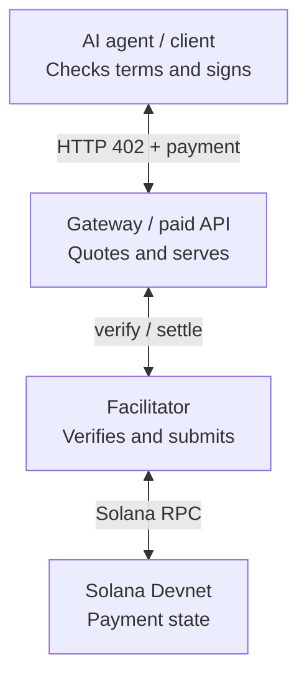
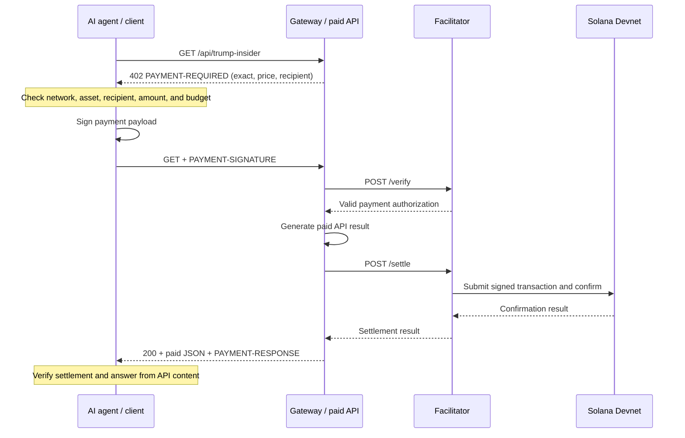
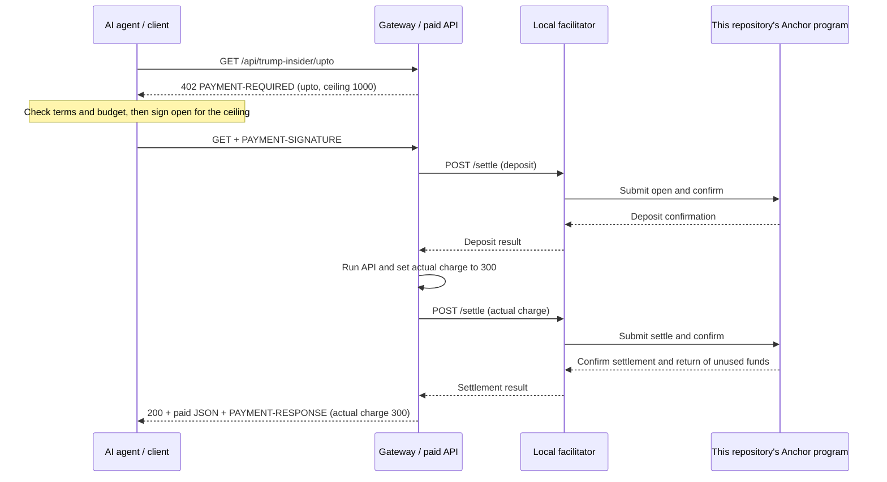
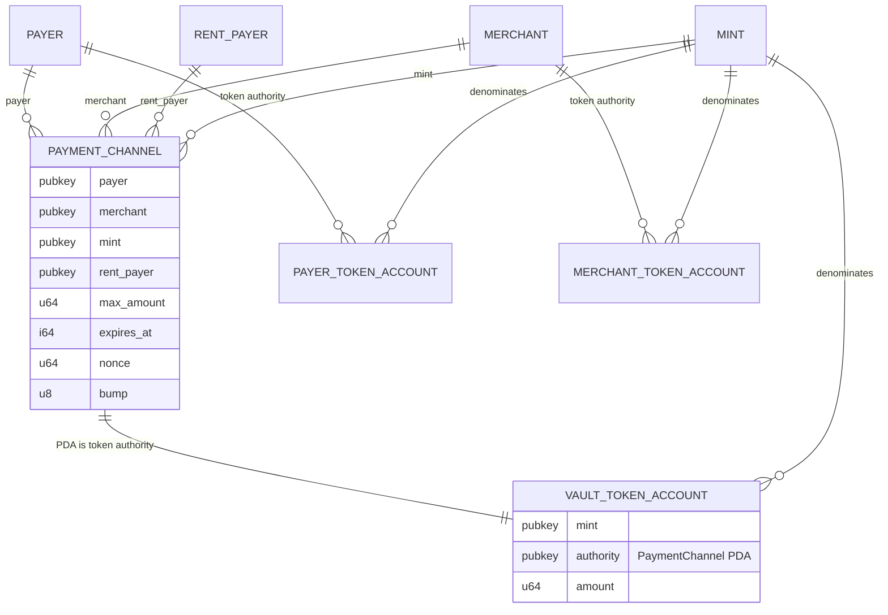

# Demo payment architecture

This document describes the current `exact` route and the `upto` route backed by this repository's Anchor program. See the [overall architecture](ARCHITECTURE.md) for the planned `batch-settlement` and `auth-capture` designs.

## Who communicates with whom

The client has the paid API URL; the gateway has the facilitator URL in `GATEWAY_FACILITATOR_URL`. The client does not send HTTP requests directly to the facilitator. The gateway uses x402's `paymentMiddleware` and `x402ResourceServer` to delegate verification and settlement to the facilitator. The facilitator is neither the recipient nor the buyer. Submitting transactions and paying network fees does not give it the client's or merchant's signing authority.

The default facilitator URL is the local `http://127.0.0.1:4022`. Both the `exact` and `upto` demos use this repository's local facilitator.

## `exact`: Confirm payment before responding

The `exact` route does not call this repository's Anchor program. The gateway's paid resource returns fictional parody JSON.

## `upto`: Deposit the ceiling, then settle the actual charge

The `upto` amounts 1000 and 300 are atomic USDC units. The charge of 300 is a fixed demo value, not measured usage. The 402 response advertises `scheme: "upto"`; the client, gateway, and facilitator use this repository's Anchor `open` and `settle` instructions. The official SVM `upto` specification uses a different fixed program ID and instruction format, so this Solana payload is not interoperable with that binding.

### Implemented `upto` account relationships

`PaymentChannel` is a PDA owned by this repository's Anchor program. Its seeds are `"channel"`, payer, merchant, mint, and nonce (a little-endian `u64`). The vault is an associated token account owned by the Token Program, with the PDA as its authority. `open` deposits the ceiling from the payer's token account. `settle` requires the merchant's signature, sends the actual charge from the vault to the merchant's token account, and returns the remainder to the payer's token account. After expiry, `refund` requires the payer's signature and returns the entire vault balance to the payer's token account. Both exit paths close the vault and `PaymentChannel`, returning account rent to `rent_payer`.

The payer and merchant token account addresses are not stored in `PaymentChannel`. Each instruction validates the mint and token authority of the accounts it receives. `PAYER_TOKEN_ACCOUNT` and `MERCHANT_TOKEN_ACCOUNT` in the diagram represent account types, not new state accounts created for each channel.

If `settle` does not run before the deposit expires, the payer can submit `refund` directly to RPC with the [refund CLI](../examples/client/README.md#recover-an-expired-upto-deposit). The gateway and facilitator are not required, but the payer needs a signature and SOL for transaction fees.

On either route, the client stops further payments when the outcome is unknown. It does not retry signed requests unconditionally. Current HTTP integration tests use a mock RPC, and Anchor state transition tests use LiteSVM. They do not establish successful live Devnet transfers.

Implementation and run instructions: [client](../examples/client/README.md), [gateway and local facilitator](../examples/gateway/README.md). Flow reference: [x402 v2 payment flows](https://github.com/x402-foundation/x402/blob/main/specs/x402-specification-v2.md#61-asset-transfer-methods-and-payment-flow-models).
