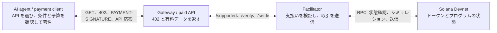
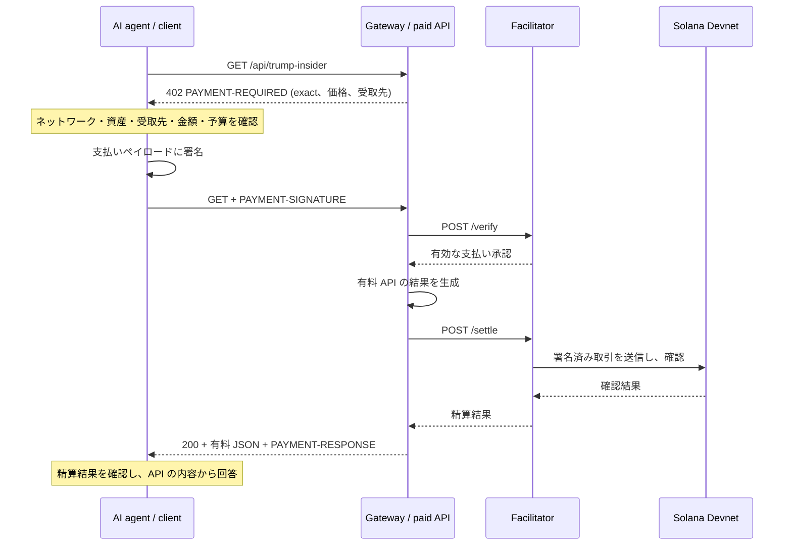
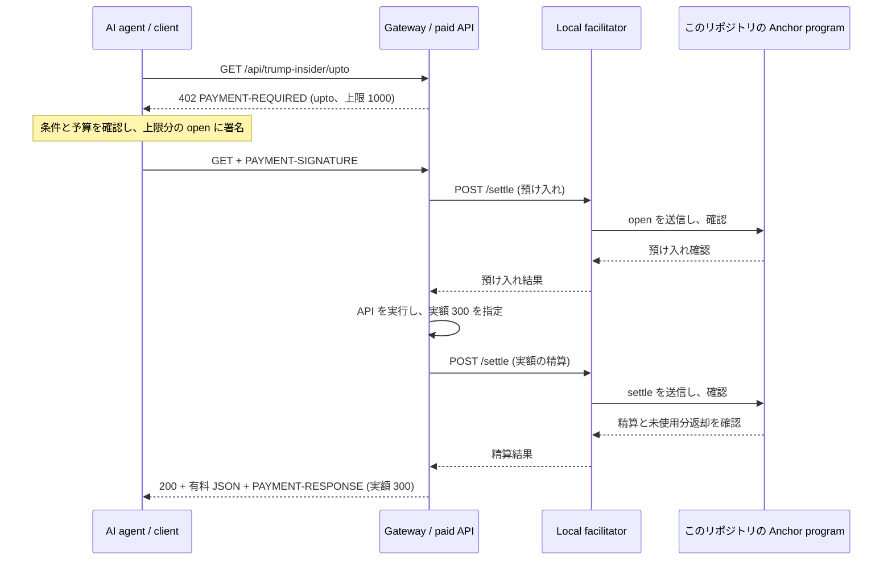
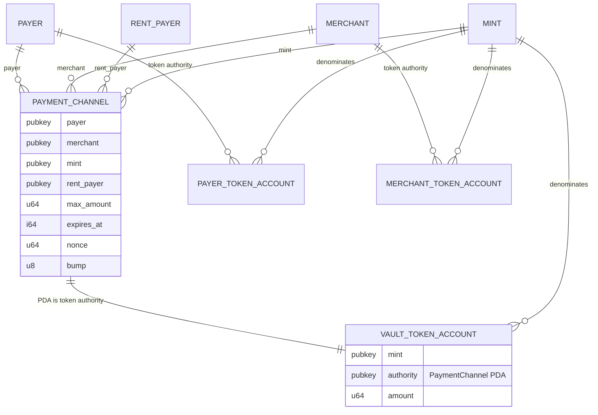

# デモの支払いアーキテクチャ

この文書は現在の `exact` と、このリポジトリの Anchor プログラムを使う `upto` ルートを説明するデモ用資料です。計画段階の `batch-settlement` と `auth-capture` の構成は [全体アーキテクチャ](ARCHITECTURE.md)を参照してください。

## 誰が誰と通信するか

支払い先の API URL は client が持ち、facilitator URL は gateway が `GATEWAY_FACILITATOR_URL` として持ちます。client は facilitator に直接 HTTP リクエストを送りません。gateway は x402 の `paymentMiddleware` と `x402ResourceServer` を使い、facilitator へ検証と精算を委ねます。facilitator は受取人でも購入者でもありません。取引の送信やネットワーク手数料の負担を担当しても、client と merchant の署名権限を代行するわけではありません。

現行の起動設定では facilitator URL の既定値はローカルの `http://127.0.0.1:4022` です。デモでは `exact` と `upto` のどちらもこのリポジトリのローカル facilitator を使います。

## `exact`: 支払いを確認してから応答する

`exact` では、このリポジトリの Anchor プログラムは呼びません。gateway の有料リソースは創作のパロディ JSON を返します。

## `upto`: 上限を先に預け、実額で精算する

`upto` の 1000 と 300 は USDC の最小単位です。300 はデモ用の固定値で、実測した利用量ではありません。402 応答では `scheme: "upto"` を広告し、client、gateway、facilitator がこのリポジトリの Anchor プログラムの `open` と `settle` を使います。公式 SVM `upto` 仕様は別の固定プログラム ID と命令形式を定めているため、この Solana ペイロードは公式バインディングと相互運用できません。

### `upto` のアカウント関係（実装済み）

`PaymentChannel` はこのリポジトリの Anchor プログラムが所有する PDA で、シードは `"channel"`、payer、merchant、mint、nonce（リトルエンディアンの `u64`）です。vault は Token Program が所有する、この PDA を authority とする関連トークン口座です。`open` で payer のトークン口座から上限額を預けます。`settle` では merchant の署名を要し、vault から merchant のトークン口座へ実額、payer のトークン口座へ残額を送ります。期限後の `refund` は payer の署名で vault の全額を payer のトークン口座へ戻します。どちらの終了経路でも vault と `PaymentChannel` を閉じ、口座 rent を `rent_payer` に返します。

payer と merchant のトークン口座アドレスは `PaymentChannel` に保存しません。各命令が渡された口座の mint と token authority を検証します。図の `PAYER_TOKEN_ACCOUNT` と `MERCHANT_TOKEN_ACCOUNT` はその口座種別であり、チャネルごとに新設する状態口座ではありません。

預け入れ後に `settle` が実行されず期限が過ぎた場合、payer は [返金 CLI](../examples/client/README.md#recover-an-expired-upto-deposit) から RPC に直接 `refund` を送れます。gateway と facilitator は不要ですが、payer の署名と取引手数料用の SOL が必要です。

いずれのルートも、支払い結果が不明な場合は client が次の支払いを止めます。署名したリクエストを無条件に繰り返す構成ではありません。現在の HTTP 結合テストは模擬 RPC、Anchor の状態遷移テストは LiteSVM を使っており、Devnet 上の実送金成功までは証明していません。

実装と実行方法: [client](../examples/client/README.md)、[gateway と local facilitator](../examples/gateway/README.md)。フローの根拠: [x402 v2 支払いフロー](https://github.com/x402-foundation/x402/blob/main/specs/x402-specification-v2.md#61-asset-transfer-methods-and-payment-flow-models)。
