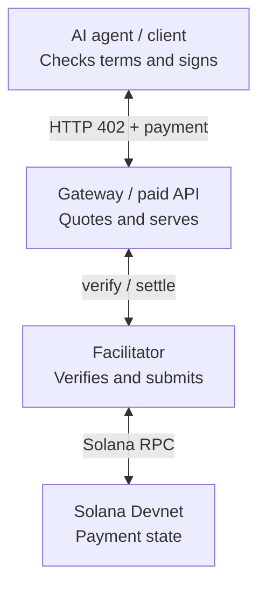
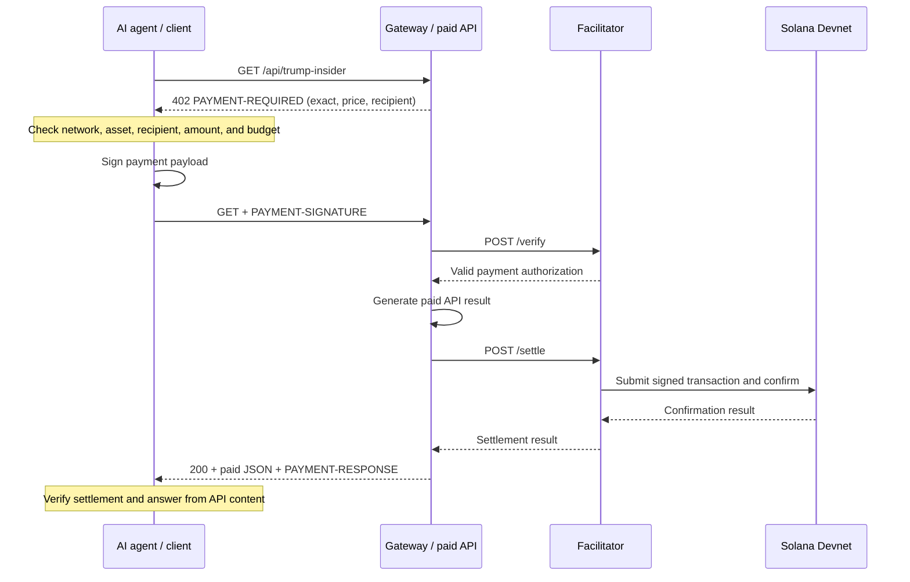
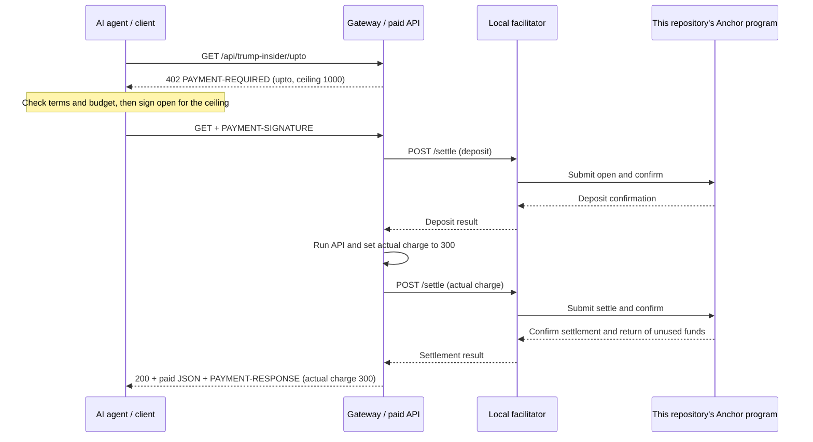
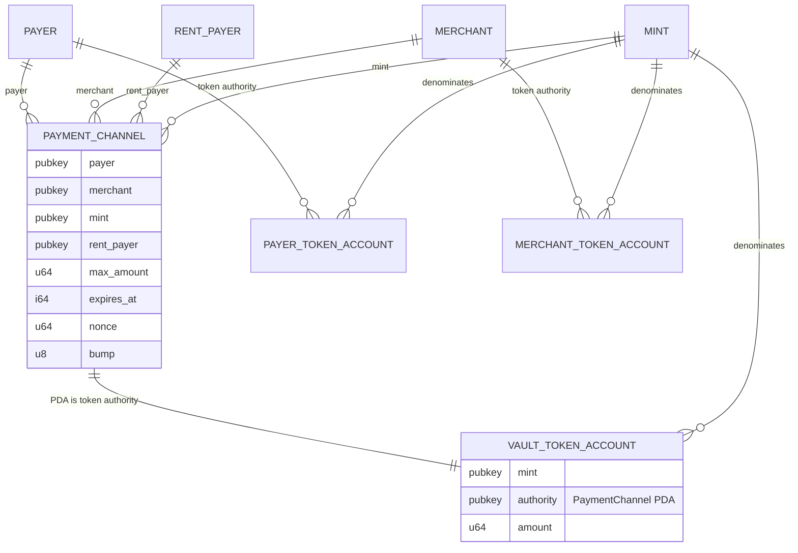

# Demo payment architecture

This document describes the current `exact`, repository-backed `upto`, official SVM `batch-settlement`, and experimental repository-backed `auth-capture` escrow routes. The auth-capture route is the Demo Day focus; see its [architecture](topics/auth-capture/ARCHITECTURE.md) and [demo runbook](topics/auth-capture/demo.md). The batch route is wired into the demo but its complete on-chain payout has not been verified. The custom Anchor #90 batch recovery remains proposed.

## Who communicates with whom



The client has the paid API URL; the gateway has the facilitator URL in `GATEWAY_FACILITATOR_URL`. The client does not send HTTP requests directly to the facilitator. The gateway uses x402's `paymentMiddleware` and `x402ResourceServer` to delegate verification and settlement to the facilitator. The facilitator is neither the recipient nor the buyer. Submitting transactions and paying network fees does not give it the client's or merchant's signing authority.

The default facilitator URL is the local `http://127.0.0.1:4022`. All enabled routes use this repository's local facilitator.

## `exact`: Confirm payment before responding



The `exact` route does not call this repository's Anchor program. The gateway's paid resource returns fictional parody JSON.

## `batch-settlement`: Accept vouchers, then redeem later

```mermaid
sequenceDiagram
    participant C as AI agent / client
    participant G as Gateway / paid API
    participant F as Local facilitator
    participant S as Foundation channel program
    C->>G: GET /api/trump-insider/batch
    G-->>C: 402 PAYMENT-REQUIRED (batch, 1000 units)
    Note over C: Check terms and budget; open funded channel on first call
    C->>G: PAYMENT-SIGNATURE (deposit or cumulative voucher)
    G->>F: Verify channel and authorization
    F-->>G: Valid channel state
    Note over G,F: On first call, settle deposit before serving
    G->>G: Persist accepted voucher and serve API
    G-->>C: 200 + paid JSON + voucher commitment
    loop Periodic redemption
        G->>F: Claim highest accepted voucher
        F->>S: Record cumulative claim
        G->>F: Distribute newly claimed amount
        F->>S: Pay confirmed delta
    end
```

The first deposit requires on-chain confirmation before the paid handler runs. Later accepted vouchers authorize charges without per-request payout transactions; an empty `transaction` in the HTTP response is expected. The gateway persists channel state, runs a periodic claim/distribution worker, and the client persists its allocation. The client can request channel close and unused-fund refund with the [batch refund command](../examples/client/README.md#close-a-batch-channel). This route uses the SDK's official channel program, not this repository's Anchor program. Tests cover the challenge, facilitator forwarding, and store recovery; they do not prove a complete on-chain batch payout or live devnet transfer.

## `upto`: Deposit the ceiling, then settle the actual charge



The `upto` amounts 1000 and 300 are atomic USDC units. The charge of 300 is a fixed demo value, not measured usage. The 402 response advertises `scheme: "upto"`; the client, gateway, and facilitator use this repository's Anchor `open` and `settle` instructions. The official SVM `upto` specification uses a different fixed program ID and instruction format, so this Solana payload is not interoperable with that binding.

## `auth-capture`: Hold before the API, capture and release afterward

```mermaid
sequenceDiagram
    participant C as Agent / payer
    participant G as Gateway / merchant
    participant F as Local facilitator
    participant P as Repository Anchor program
    C->>G: GET /api/trump-insider/auth-capture
    G-->>C: 402 with 1000-unit ceiling and deadlines
    C->>C: Check terms and budget; sign authorize_hold
    C->>G: Retry with PAYMENT-SIGNATURE
    G->>F: Settle payer-signed hold
    F->>P: Sponsor and confirm 1000-unit deposit
    P-->>G: Hold confirmed
    G->>G: Run fictional paid API
    G->>F: Settle merchant-signed capture_and_void_hold(300)
    F->>P: Capture 300; return 700 atomically
    P-->>G: Capture confirmed
    G-->>C: Paid JSON + PAYMENT-RESPONSE + payment ID
    opt Later merchant-approved refund
        G->>P: Direct CLI refund_captured(100)
        P-->>C: Merchant tokens return to payer
    end
```

The program records the payment PDA, fixed accounts, deadlines, amounts, and operation sequence. A payer can directly reclaim only an unfinished hold after the capture deadline. Later operations use direct signed CLI transactions; they do not go through facilitator `/settle`. The route is a custom escrow-only binding, with classic SPL Token and zero protocol fees. LiteSVM and simulated-RPC HTTP tests cover the local path; live Devnet settlement remains unverified. See the [gateway guide](../examples/gateway/README.md#experimental-auth-capture-escrow-flow).

### Implemented `upto` account relationships



`PaymentChannel` is a PDA owned by this repository's Anchor program. Its seeds are `"channel"`, payer, merchant, mint, and nonce (a little-endian `u64`). The vault is an associated token account owned by the Token Program, with the PDA as its authority. `open` deposits the ceiling from the payer's token account. `settle` requires the merchant's signature, sends the actual charge from the vault to the merchant's token account, and returns the remainder to the payer's token account. After expiry, `refund` requires the payer's signature and returns the entire vault balance to the payer's token account. Both exit paths close the vault and `PaymentChannel`, returning account rent to `rent_payer`.

The payer and merchant token account addresses are not stored in `PaymentChannel`. Each instruction validates the mint and token authority of the accounts it receives. `PAYER_TOKEN_ACCOUNT` and `MERCHANT_TOKEN_ACCOUNT` in the diagram represent account types, not new state accounts created for each channel.

If `settle` does not run before the deposit expires, the payer can submit `refund` directly to RPC with the [refund CLI](../examples/client/README.md#recover-an-expired-upto-deposit). The gateway and facilitator are not required, but the payer needs a signature and SOL for transaction fees.

On all routes, the client stops further payments when the outcome is unknown. It does not retry signed requests unconditionally; the batch SDK can use a bounded corrective 402 resynchronization. Current exact and upto HTTP integration tests use a mock RPC, batch tests cover the quote and stores, and Anchor state transition tests cover `upto` in LiteSVM. They do not establish successful live Devnet transfers.

Implementation and run instructions: [client](../examples/client/README.md), [gateway and local facilitator](../examples/gateway/README.md). Flow reference: [x402 v2 payment flows](https://github.com/x402-foundation/x402/blob/main/specs/x402-specification-v2.md#61-asset-transfer-methods-and-payment-flow-models).
