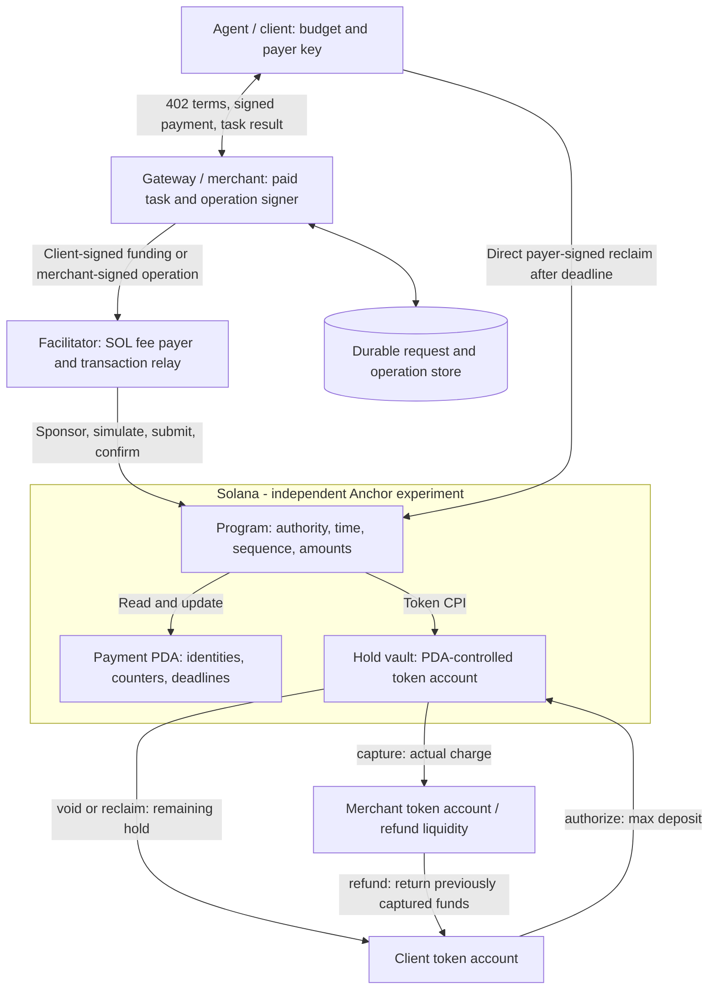
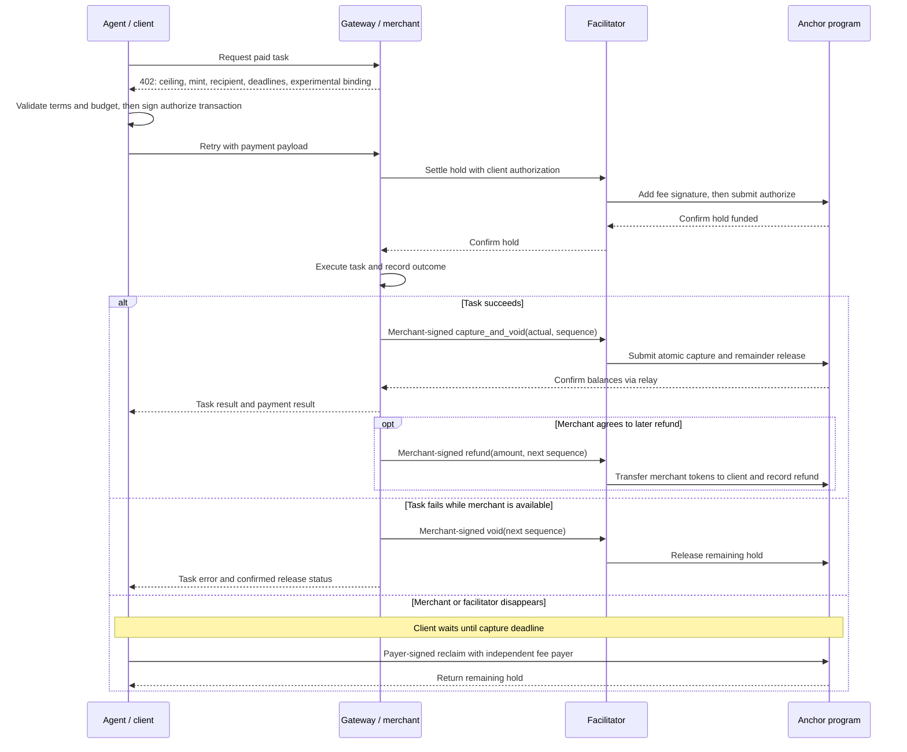
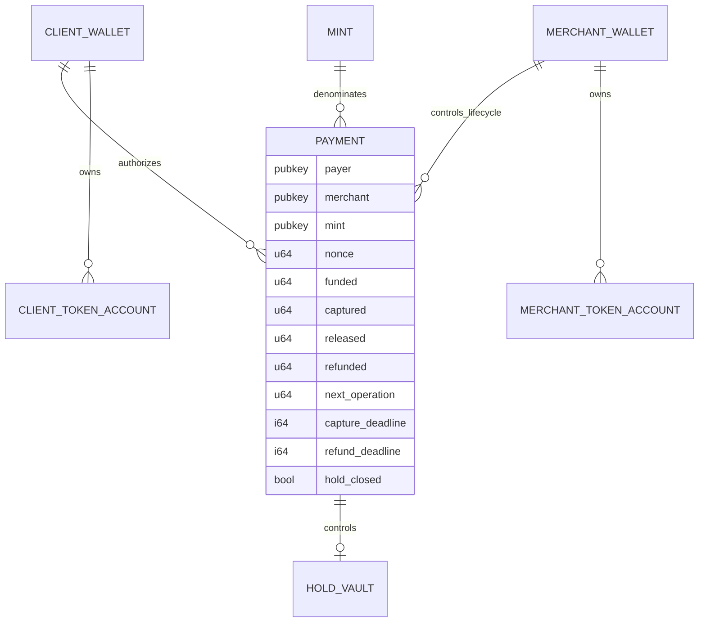

# Solana auth-capture architecture (proposed)

This is a separate presentation and design track from [Issue #90](../closing-settlement/ARCHITECTURE.md#design-focus-issue-90-planned). The repository still targets all four x402 schemes. This document focuses on a proposed Solana auth-capture binding and independent Anchor implementation. No payment functionality described here is implemented yet.

## Evidence and scope

x402 baseline: `cb0ec5bca0a5b21860a36bb60f34433c2e8e0d71`.

| Observation | Evidence and limit |
| --- | --- |
| The generic scheme defines authorize, charge, capture, void, refund, and client reclaim, with escrow and authorization flows. | [Generic specification](https://github.com/x402-foundation/x402/blob/cb0ec5bca0a5b21860a36bb60f34433c2e8e0d71/specs/schemes/auth-capture/scheme_auth_capture.md). |
| No Solana-specific auth-capture specification or SDK implementation was found in the reviewed official tree. | [Scheme directory](https://github.com/x402-foundation/x402/tree/cb0ec5bca0a5b21860a36bb60f34433c2e8e0d71/specs/schemes/auth-capture), [SVM SDK source](https://github.com/x402-foundation/x402/tree/cb0ec5bca0a5b21860a36bb60f34433c2e8e0d71/typescript/packages/mechanisms/svm/src). This is a bounded search result, not proof that no private or third-party implementation exists. |
| A binding must define authorization, operator authority, replay checks, deadlines, refund funding, and partial capture with remainder release. | [Network requirements](https://github.com/x402-foundation/x402/blob/cb0ec5bca0a5b21860a36bb60f34433c2e8e0d71/specs/schemes/auth-capture/scheme_auth_capture.md#network-requirements). |

In the reviewed documentation snapshot, the [buyer quickstart](https://docs.x402.org/getting-started/quickstart-for-buyers#payment-schemes) and [seller quickstart](https://docs.x402.org/getting-started/quickstart-for-sellers#payment-schemes-exact-upto-and-batch-settlement) describe only `exact`, `upto`, and `batch-settlement`. The [scheme overview](https://docs.x402.org/schemes/overview) and [core specification](https://github.com/x402-foundation/x402/blob/main/specs/x402-specification-v2.md#6-payment-schemes-the-logic) also list `auth-capture`; the [SDK feature table](https://docs.x402.org/sdk-features) reports EVM implementations in TypeScript and Go, but no SVM implementation. The [public facilitator's capabilities](https://x402.org/facilitator/supported) do not advertise `auth-capture`. The quickstart omission does not remove the scheme from the specification, but it is a documentation and deployment gap to recheck before presenting.

The following accounts, messages, state transitions, and deployment choices are **our proposed design**, not an official SVM specification. No first-implementation or interoperability claim is made. Recheck specifications, SDKs, and related PRs before implementation and presentation.

## Focused demonstrator

Show an agent authorizing at most 1 test token for the same fictional `/api/trump-insider` resource used by the `exact` demo. Hold that amount, return the parody answer, capture 0.3, and release the remaining 0.7. Later refund 0.1 from the merchant's wallet. Separately demonstrate an abandoned hold recovered by the client after its deadline. These illustrative amounts are not benchmark results; the API content makes no claim of real non-public information.

Start with the escrow flow, one recipient, one legacy SPL test mint with no transfer fees, integer token base units, and zero protocol fees. Use local TypeScript applications and LiteSVM for deterministic tests before a devnet demonstration. The merchant retains discretion over capture/refund; the program does not prove service quality or guarantee a merchant-funded refund when the merchant refuses or lacks funds.

The broader auth-capture implementation must also address the authorization flow's direct `charge`. That requires its own client authorization design and tests; it is not silently treated as an escrow flow. A working escrow demo alone is not completion of the entire scheme.

## Actors and trust boundaries

| Actor | Responsibility | Authority |
| --- | --- | --- |
| Agent / payment tool | Check terms and budget; sign funding; keep payment reference; request recovery | Payer key, excluded from model prompts |
| Gateway / merchant | Execute task, choose actual capture, authorize cancellations and refunds | Merchant operation key; in this demo also owns the receipt/refund token account |
| Facilitator | Simulate, sponsor fees, submit authorized transactions, reconcile outcomes | SOL fee-payer key; cannot replace payer or merchant signatures |
| Anchor program | Enforce accounts, signatures, deadlines, accounting, and operation sequence | Payment PDA controls held tokens |
| Persistent store | Retain request status, intended operations, signatures and confirmation results | Off-chain operational state; never overrides on-chain balances |

Gateway and facilitator may run locally but use distinct keys. The merchant signs each lifecycle transaction; the facilitator adds its fee-payer signature without altering the transaction. This demo avoids a second off-chain signature-verification protocol. Later relaying designs can introduce domain-separated message signatures with equivalent tests.

## Proposed Solana escrow binding and wire path

This is a **project-specific sketch**, not an official SVM auth-capture profile. It uses the x402 v2 [HTTP headers](https://github.com/x402-foundation/x402/blob/main/specs/transports-v2/http.md) and the generic [auth-capture lifecycle](https://github.com/x402-foundation/x402/blob/main/specs/schemes/auth-capture/scheme_auth_capture.md). JSON field names under `extra` and `payload` below are proposed for this binding; their exact encoding and a binding identifier must be frozen before implementation.

| Boundary | Proposed data / action | Authority and check |
| --- | --- | --- |
| `402` and `PAYMENT-REQUIRED` | `accepts[]` advertises `scheme: "auth-capture"`, Solana CAIP-2 `network`, ceiling `amount` in token base units, `asset` mint, `payTo` merchant, and `extra` with `paymentFlow: "escrow"`, `captureDeadline`, `refundDeadline`, token program, proposed binding ID, and Anchor program ID. | Agent checks amount, merchant, mint, deadlines, binding, and local budget before signing. |
| Retry and `PAYMENT-SIGNATURE` | x402 `PaymentPayload` carries `accepted` requirements plus proposed `payload` fields: payer, `nonce`, derived `paymentId` (PDA), and a base64 serialized payer-signed `authorize` transaction. | Transaction signs immutable payer/merchant, mint/program, destinations, ceiling, nonce, and deadlines. Facilitator checks the signed transaction and accepted terms before adding only its SOL fee-payer signature. |
| First facilitator `/settle` | Standard envelope contains `x402Version`, `paymentPayload`, and `paymentRequirements`; the binding infers `authorize` from `paymentFlow: "escrow"`. | Confirm the one-time on-chain hold before the merchant runs the paid task. A repeated `paymentId` cannot fund a second hold. |
| Finalize or later refund `/settle` | Resource server sends the same payment reference with `payload.type: "capture" | "void" | "refund"`, `paymentId`, `sequence`, amount where relevant, and a merchant-signed transaction. A proposed `releaseRemainder: true` on `capture` maps to one atomic `capture_and_void` instruction. | Facilitator verifies expected program, instruction, accounts, exact operation fields, merchant signature, and sequence before sponsoring. Program checks the deadline and remaining amount; merchant's signature supplies server consent. |
| Payer escape | After `captureDeadline`, the client sends payer-signed `reclaim` directly to Solana with its own fee payer. | Program returns only the remaining hold to the fixed payer destination. No facilitator or merchant consent is needed. |

The payment PDA is derived from a versioned seed domain, payer key, and unique `u64` nonce under the chosen Anchor program ID. Its proposed persistent record holds version/bump, payer, merchant, mint, token program, fixed payer and merchant token accounts, nonce, funded/captured/released/refunded counters, next operation sequence, both deadlines, and `hold_closed`. The PDA controls a vault token account for the hold. It stays after the vault closes so a repeated authorization or old operation cannot recreate value. `capture`, `capture_and_void`, `void`, `reclaim`, and `refund` map to the Anchor instructions of the same names; the merchant signs all except payer-only `reclaim`. For a refund, the program transfers from the merchant's fixed token account to the payer's fixed account and updates `refunded` in the same transaction. No vault balance is used for that refund.

The binding must reject transactions with an unexpected program or token instruction, altered immutable terms, extra spending, wrong mint/destination, unsupported token extensions, missing signatures, reused `paymentId`, stale `sequence`, and excess amounts. A facilitator timeout is reconciled against the transaction signature and payment PDA before retrying. `payload.type: "charge"` and `extra.paymentFlow: "authorization"` are rejected in the escrow-only milestone; they require a separate direct-charge design and implementation. This sketch specifies the architecture-level contract, not finalized byte-level serialization or HTTP error codes.

Token arrows describe validated program operations, not arbitrary transfers. `void`/`reclaim` use the hold vault; `refund` uses merchant liquidity after money has left that vault. Refund is merchant-authorized, not a unilateral clawback from the merchant. This funding choice addresses the generic specification's refund-funding requirement.

## Escrow request and lifecycle flow

The HTTP layer uses the [x402 v2 transport](https://github.com/x402-foundation/x402/blob/cb0ec5bca0a5b21860a36bb60f34433c2e8e0d71/specs/transports-v2/http.md). Initial `/settle` establishes the hold; a later `/settle` carries the merchant-authorized lifecycle operation. Client reclaim is direct. These conventions follow the [generic lifecycle specification](https://github.com/x402-foundation/x402/blob/cb0ec5bca0a5b21860a36bb60f34433c2e8e0d71/specs/schemes/auth-capture/scheme_auth_capture.md); the concrete Solana transaction format remains our binding proposal.

A transaction timeout is an unknown outcome. Persist the payment/operation identity, inspect signature status and on-chain counters, then reconcile before retrying. Do not report a refund or release until confirmed. If the merchant fails after capturing, reclaim recovers only the remaining hold; it does not undo capture.

## Proposed accounts and accounting

For the escrow demo, derive the payment PDA from a versioned domain, payer, and unique nonce under this program ID. Store merchant, mint, fixed client/merchant destinations, token program, ceiling, flow, and deadlines as immutable terms. The client-signed funding transaction binds them. Field names are logical, not finalized Anchor serialization. A vault exists while holding funds; the payment record survives vault closure for refunds and replay protection.

- `remaining_hold = funded - captured - released`; all arithmetic is checked.
- `captured + released <= funded`, and `refunded <= captured`.
- Refund does not decrement lifetime `captured` or replenish capture capacity.
- `capture_and_void` transfers the actual charge and releases the remainder atomically.
- Keep payment records for the demo; do not close and recreate a PDA to bypass nonce replay protection. Rent cleanup requires a separately designed persistent replay mechanism.
- Unsolicited vault transfers do not increase spending authorization. Define a separate dust/cleanup policy before closing token accounts; no accounting is inferred from raw balances.

| Operation | Required authority / condition | Effect |
| --- | --- | --- |
| authorize | Payer signature; unique payment; valid future deadlines; supported accounts | Deposit ceiling and initialize immutable terms once |
| capture | Merchant signature; expected operation sequence; now before capture deadline; amount within remaining hold | Pay merchant, increment captured and sequence |
| capture_and_void | Same capture checks; positive hold; actual may be zero | Atomically capture actual and release remainder; mark hold closed |
| void | Merchant signature; expected sequence; positive remaining hold | Release all remaining hold to fixed client destination |
| reclaim | Payer signature; now at or after capture deadline; positive remaining hold | Release remaining hold without gateway/facilitator involvement |
| refund | Merchant signature and token authority; expected sequence; now before refund deadline; amount within captured minus refunded | Transfer merchant-funded tokens to client; increment refunded and sequence |

For this proposal, allow `void` after the capture deadline as a voluntary release; `capture` is then forbidden and client reclaim is available. Both release the same fixed remaining amount, atomically, so whichever lands first makes the other ineligible. Require `refund_deadline >= capture_deadline`; precise validation and wire encoding must be pinned before coding. In the demo, zero protocol fees remove fee-split accounting; network fees are paid separately in SOL.

## Binding and implementation milestones

1. Specify experimental binding identity, immutable terms, payer transaction payload, server operation authorization, error mapping, and operation sequence semantics. Do not advertise an official Solana auth-capture profile that has not been established.
2. Implement authorize/capture/void/reclaim with LiteSVM balance and boundary tests.
3. Add merchant-funded partial/repeated refunds and atomic capture-and-void. Test insufficient merchant liquidity and failed token transfers without counter changes.
4. Connect gateway/facilitator recovery and the agent payment tool; demonstrate the escrow path on devnet.
5. Specify and implement direct `charge` for the authorization flow, including maximum authorization, actual-amount server consent, and single-use collection. Until then, reject that flow explicitly and describe coverage as escrow-only.

Client authorization for a variable direct charge, exact HTTP error mapping, operation-sequence conflict handling across workers, program-ID negotiation for the experimental binding, and account cleanup remain design decisions. The diagrams above intentionally cover the escrow demonstrator, not an already-complete four-scheme implementation.

## Acceptance criteria and demo evidence

- Successful deposit, partial/repeated capture, capture-and-void, void, direct deadline reclaim, partial/repeated refund.
- Reject wrong payer/merchant, mint/program/destination substitutions, oversized amounts, stale sequences, duplicate funding, and attempts to reuse a closed payment identity.
- Exercise time immediately before, at, and after each deadline; capture and reclaim have disjoint permitted times.
- Merchant refund liquidity failure leaves balances and counters unchanged. Releasing unused hold and refunding captured funds are separate tests.
- Restart and submission-timeout recovery must not collect or refund twice; no paid task executes before hold confirmation.
- Record transaction IDs, balances, fixture setup, and selected program/spec commits. Present these as future criteria until tests actually run.

The contribution target is a documented, testable Solana binding and prototype. No claim is made that this is the first implementation, that escrow proves service delivery, or that all generic scheme behavior is covered by the initial demo.
