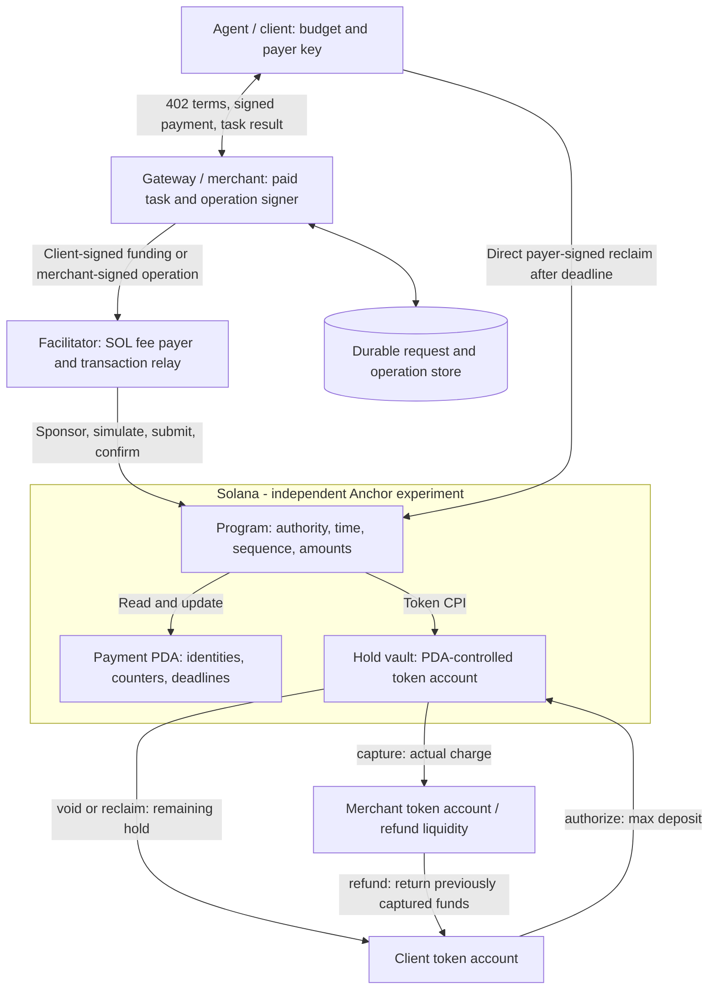
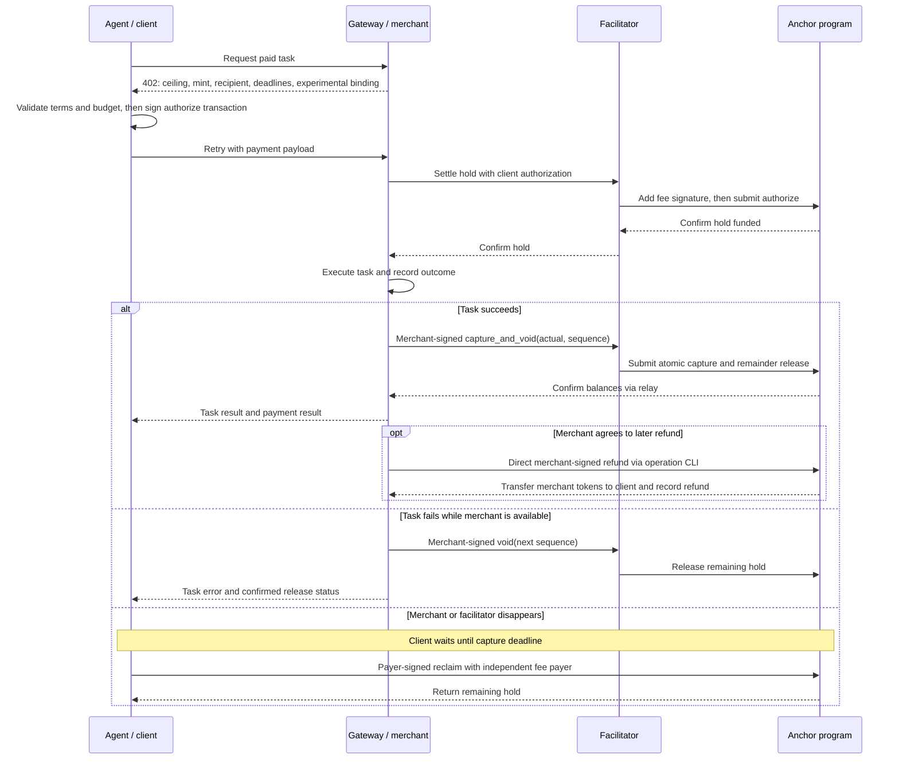
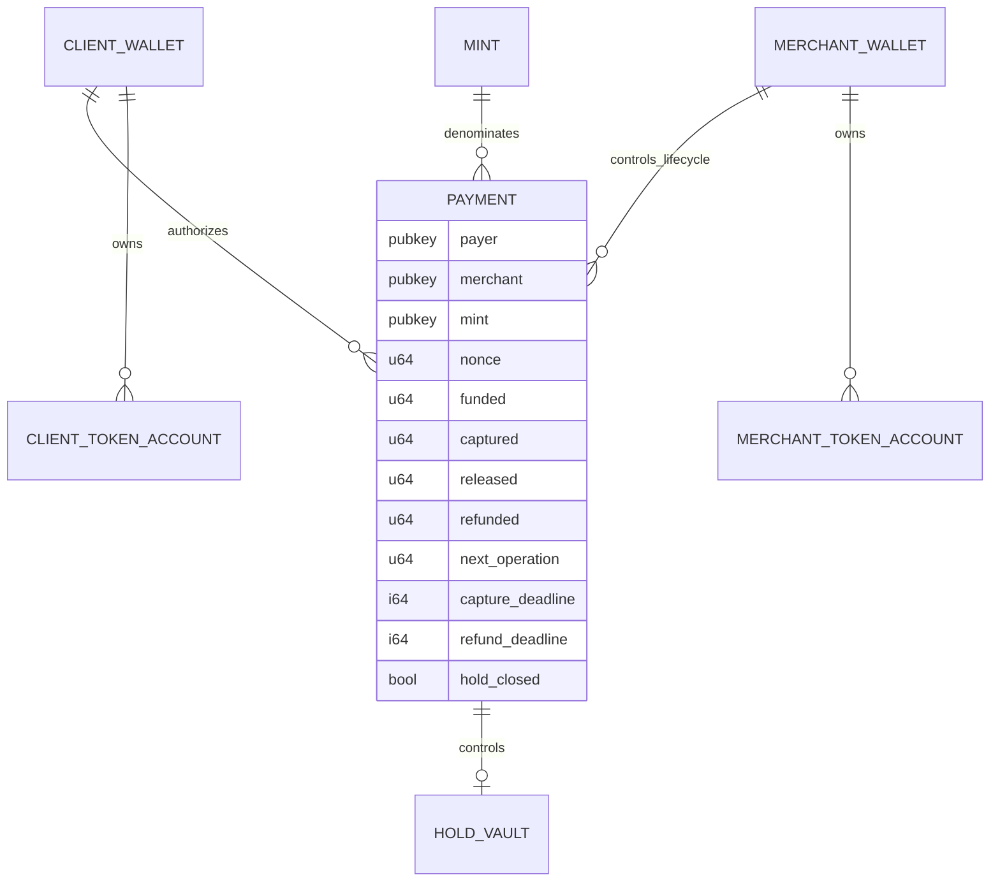

# Solana auth-capture architecture (experimental escrow binding)

This is the main Demo Day architecture track. The repository still targets all four x402 schemes. This document describes an experimental Solana escrow binding implemented in this repository's Anchor program and TypeScript demo. It is independent of the Foundation payment-channels program and [Issue #90](../closing-settlement/ARCHITECTURE.md#design-focus-issue-90-planned).

## Implementation status

| Part | Current evidence |
| --- | --- |
| Escrow program | `authorize_hold`, partial `capture_hold`, atomic `capture_and_void_hold`, `void_hold`, payer-only `reclaim_hold`, and merchant-funded `refund_captured` are implemented. LiteSVM tests cover a successful partial capture/release/refund, deadline reclaim, invalid authority, overcharge, replay, duplicate funding, and insufficient refund liquidity. |
| HTTP demo | The opt-in `/api/trump-insider/auth-capture` route advertises the experimental binding and deadlines. The browser agent, gateway, facilitator, and deployed program completed a 1000-unit hold, synchronous 300-unit capture, and 700-unit release on a real local validator with a test token. The HTTP integration test separately uses simulated RPC. |
| Later operations | The merchant or payer can submit direct signed lifecycle transactions with the client operation CLI. A 100-unit merchant-funded refund was confirmed on the local validator and shown in the browser's refreshed RPC panel. This is the binding's out-of-band path; later facilitator `/settle` calls are not implemented. |
| Not implemented or verified | The generic `authorization → charge` flow, official SVM interoperability, and live Devnet payment/balance reconciliation. The custom program itself is deployed on Devnet. |

The implemented path follows the generic [escrow lifecycle](https://github.com/x402-foundation/x402/blob/main/specs/schemes/auth-capture/scheme_auth_capture.md) but does **not** cover the full `auth-capture` scheme. The explicit experimental binding ID is `anchor-auth-capture-escrow-v1`; the demo supports one classic SPL mint, one merchant, associated token accounts, and zero protocol fees. The custom program does not contain the Issue #90 Closing settlement change.

## Evidence and scope

x402 baseline: `cb0ec5bca0a5b21860a36bb60f34433c2e8e0d71`.

| Observation | Evidence and limit |
| --- | --- |
| The generic scheme defines authorize, charge, capture, void, refund, and client reclaim, with escrow and authorization flows. | [Generic specification](https://github.com/x402-foundation/x402/blob/cb0ec5bca0a5b21860a36bb60f34433c2e8e0d71/specs/schemes/auth-capture/scheme_auth_capture.md). |
| No Solana-specific auth-capture specification or SDK implementation was found in the reviewed official tree. | [Scheme directory](https://github.com/x402-foundation/x402/tree/cb0ec5bca0a5b21860a36bb60f34433c2e8e0d71/specs/schemes/auth-capture), [SVM SDK source](https://github.com/x402-foundation/x402/tree/cb0ec5bca0a5b21860a36bb60f34433c2e8e0d71/typescript/packages/mechanisms/svm/src). This is a bounded search result, not proof that no private or third-party implementation exists. |
| A binding must define authorization, operator authority, replay checks, deadlines, refund funding, and partial capture with remainder release. | [Network requirements](https://github.com/x402-foundation/x402/blob/cb0ec5bca0a5b21860a36bb60f34433c2e8e0d71/specs/schemes/auth-capture/scheme_auth_capture.md#network-requirements). |

In the reviewed documentation snapshot, the [buyer quickstart](https://docs.x402.org/getting-started/quickstart-for-buyers#payment-schemes) and [seller quickstart](https://docs.x402.org/getting-started/quickstart-for-sellers#payment-schemes-exact-upto-and-batch-settlement) describe only `exact`, `upto`, and `batch-settlement`. The [scheme overview](https://docs.x402.org/schemes/overview) and [core specification](https://github.com/x402-foundation/x402/blob/main/specs/x402-specification-v2.md#6-payment-schemes-the-logic) also list `auth-capture`; the [SDK feature table](https://docs.x402.org/sdk-features) reports EVM implementations in TypeScript and Go, but no SVM implementation. The [public facilitator's capabilities](https://x402.org/facilitator/supported) do not advertise `auth-capture`. The quickstart omission does not remove the scheme from the specification, but it is a documentation and deployment gap to recheck before presenting.

The implemented escrow subset and remaining proposals below are **our binding**, not an official SVM specification. No first-implementation or interoperability claim is made. Recheck specifications, SDKs, and related PRs before presentation.

## Focused demonstrator

Show an agent authorizing a 1000-unit ceiling for the same fictional `/api/trump-insider` resource used by the `exact` demo. Hold 1000 atomic USDC units, return the parody answer, capture 300, and release the remaining 700. Later refund 100 from the merchant's wallet. Separately demonstrate an abandoned hold recovered by the client after its deadline. At six decimals, 1000 atomic units equal 0.001 USDC; these illustrative amounts are not benchmark results. The API content makes no claim of real non-public information.

Start with the escrow flow, one recipient, one legacy SPL test mint with no transfer fees, integer token base units, and zero protocol fees. Use local TypeScript applications and LiteSVM for deterministic tests before a devnet demonstration. The merchant retains discretion over capture/refund; the program does not prove service quality or guarantee a merchant-funded refund when the merchant refuses or lacks funds.

The broader auth-capture implementation must also address the authorization flow's direct `charge`. That requires its own client authorization design and tests; it is not silently treated as an escrow flow. A working escrow demo alone is not completion of the entire scheme.

## Actors and trust boundaries

| Actor | Responsibility | Authority |
| --- | --- | --- |
| Agent / payment tool | Check terms and budget; sign funding; keep payment reference; request recovery | Payer key, excluded from model prompts |
| Gateway / merchant | Execute task, choose actual capture, authorize cancellations and refunds | Merchant operation key; in this demo also owns the receipt/refund token account |
| Facilitator | Simulate, sponsor fees, submit authorized transactions, reconcile outcomes | SOL fee-payer key; cannot replace payer or merchant signatures |
| Anchor program | Enforce accounts, signatures, deadlines, accounting, and operation sequence | Payment PDA controls held tokens |
| Persistent store | Retain request status, intended operations, signatures and confirmation results | Off-chain operational state; never overrides on-chain balances |

Gateway and facilitator may run locally but use distinct keys. The merchant signs each lifecycle transaction; the facilitator adds its fee-payer signature without altering the transaction. This demo avoids a second off-chain signature-verification protocol. Later relaying designs can introduce domain-separated message signatures with equivalent tests.

## Implemented Solana escrow binding and wire path

This is a **project-specific binding**, not an official SVM auth-capture profile. The escrow route uses x402 v2 [HTTP headers](https://github.com/x402-foundation/x402/blob/main/specs/transports-v2/http.md) and the generic [auth-capture lifecycle](https://github.com/x402-foundation/x402/blob/main/specs/schemes/auth-capture/scheme_auth_capture.md). Its `extra` fields include `binding: "anchor-auth-capture-escrow-v1"`, `programId`, `feePayer`, `paymentFlow: "escrow"`, `assetTransferMethod: "escrow"`, and absolute capture/refund deadlines. The HTTP payload carries payer, nonce, payment PDA, those deadlines, and a payer-signed `authorize_hold` transaction.

| Boundary | Data / action | Authority and check |
| --- | --- | --- |
| `402` and `PAYMENT-REQUIRED` | `accepts[]` advertises `scheme: "auth-capture"`, Solana CAIP-2 `network`, ceiling `amount` in token base units, `asset` mint, `payTo` merchant, and `extra` with `paymentFlow: "escrow"`, `captureDeadline`, `refundDeadline`, binding ID, and Anchor program ID. | Agent checks amount, merchant, mint, deadlines, binding, and local budget before signing. |
| Retry and `PAYMENT-SIGNATURE` | x402 `PaymentPayload` carries `accepted` requirements plus proposed `payload` fields: payer, `nonce`, derived `paymentId` (PDA), and a base64 serialized payer-signed `authorize` transaction. | Transaction signs immutable payer/merchant, mint/program, destinations, ceiling, nonce, and deadlines. Facilitator checks the signed transaction and accepted terms before adding only its SOL fee-payer signature. |
| First facilitator `/settle` | Standard envelope contains `x402Version`, `paymentPayload`, and `paymentRequirements`; the binding infers `authorize` from `paymentFlow: "escrow"`. | Confirm the one-time on-chain hold before the merchant runs the paid task. A repeated `paymentId` cannot fund a second hold. |
| In-request finalize `/settle` | Gateway adds `payload.type: "capture"`, `paymentId`, and a merchant-signed `capture_and_void_hold` transaction for the actual amount; the program releases the remainder atomically. | Facilitator checks the exact instruction, accounts, merchant signature, and amount before sponsoring. Program checks deadline, sequence, and remaining hold. |
| Later lifecycle | `auth-capture:operate` reads the payment PDA and submits merchant-signed capture, void, or refund directly. Later facilitator `/settle` support is future work. | Program checks authority, sequence, deadline, and balance. Merchant supplies refund liquidity. |
| Payer escape | After `captureDeadline`, the client sends payer-signed `reclaim` directly to Solana with its own fee payer. | Program returns only the remaining hold to the fixed payer destination. No facilitator or merchant consent is needed. |

The payment PDA is derived from the `auth-capture` seed domain, payer key, and unique `u64` nonce under this Anchor program ID. Its persistent record holds the payer, merchant, mint, fixed payer/merchant token accounts, vault address, nonce, funded/captured/released/refunded counters, next operation sequence, both deadlines, `hold_closed`, and bump. The PDA controls a vault token account for the hold. Both record and vault remain allocated after the hold is spent so a repeated authorization cannot recreate value; rent cleanup remains future work. `capture_hold`, `capture_and_void_hold`, `void_hold`, `reclaim_hold`, and `refund_captured` are the implemented Anchor instructions; the merchant signs all except payer-only `reclaim_hold`. Refund transfers from the merchant's fixed token account to the payer's fixed account and updates `refunded` in the same transaction. No vault balance is used for that refund.

The facilitator validates the expected program instruction, immutable terms, accounts, signatures, payment ID, and amount before sponsoring. The program rejects reused payment IDs, stale sequences, invalid authorities, and excess amounts. A timeout needs signature and payment-PDA reconciliation before retrying. `payload.type: "charge"` and `extra.paymentFlow: "authorization"` are unsupported; they require a separate direct-charge design. The shared helpers define this local instruction format; interoperable error mapping remains open.

Token arrows describe validated program operations, not arbitrary transfers. `void`/`reclaim` use the hold vault; `refund` uses merchant liquidity after money has left that vault. Refund is merchant-authorized, not a unilateral clawback from the merchant. This funding choice addresses the generic specification's refund-funding requirement.

## Escrow request and lifecycle flow

The HTTP layer uses the [x402 v2 transport](https://github.com/x402-foundation/x402/blob/cb0ec5bca0a5b21860a36bb60f34433c2e8e0d71/specs/transports-v2/http.md). The first facilitator `/settle` establishes the hold; a second `/settle` captures the charge and releases the remainder after the handler. If the handler is canceled, the second `/settle` names `void` and submits a merchant-signed `void_hold`. Later refund, capture, void, and payer reclaim use the direct operation CLI, outside HTTP `/settle`. The concrete Solana transaction format is our project-specific binding.

A transaction timeout is an unknown outcome. Persist the payment/operation identity, inspect signature status and on-chain counters, then reconcile before retrying. Do not report a refund or release until confirmed. If the merchant fails after capturing, reclaim recovers only the remaining hold; it does not undo capture.

## Accounts and accounting

The payment PDA uses the `auth-capture` seed domain, payer, and unique nonce under this program ID. The state stores payer, merchant, mint, fixed client/merchant token accounts, vault address, funded amount, nonce, counters, and deadlines. The client-signed funding transaction binds these terms. The payment record and vault stay allocated after the hold is spent for replay protection. Classic SPL Token is fixed by the instruction account constraints; the state does not store a token-program field.

- `remaining_hold = funded - captured - released`; all arithmetic is checked.
- `captured + released <= funded`, and `refunded <= captured`.
- Refund does not decrement lifetime `captured` or replenish capture capacity.
- `capture_and_void` transfers the actual charge and releases the remainder atomically.
- Keep payment records for the demo; do not close and recreate a PDA to bypass nonce replay protection. Rent cleanup requires a separately designed persistent replay mechanism.
- Unsolicited vault transfers do not increase spending authorization. Define a separate dust/cleanup policy before closing token accounts; no accounting is inferred from raw balances.

| Operation | Required authority / condition | Effect |
| --- | --- | --- |
| authorize | Payer signature; unique payment; valid future deadlines; supported accounts | Deposit ceiling and initialize immutable terms once |
| capture | Merchant signature; expected operation sequence; now before capture deadline; amount within remaining hold | Pay merchant, increment captured and sequence |
| capture_and_void | Same capture checks; positive hold; actual may be zero | Atomically capture actual and release remainder; mark hold closed |
| void | Merchant signature; expected sequence; positive remaining hold | Release all remaining hold to fixed client destination |
| reclaim | Payer signature; now at or after capture deadline; positive remaining hold | Release remaining hold without gateway/facilitator involvement |
| refund | Merchant signature and token authority; expected sequence; now before refund deadline; amount within captured minus refunded | Transfer merchant-funded tokens to client; increment refunded and sequence |

The program allows `void` after the capture deadline as a voluntary release; `capture` is then forbidden and client reclaim is available. Both release the same fixed remaining amount, atomically, so whichever lands first makes the other ineligible. Authorization requires `refund_deadline >= capture_deadline`. In the demo, zero protocol fees remove fee-split accounting; network fees are paid separately in SOL.

## Binding and implementation milestones

1. **Implemented locally:** experimental binding identity, immutable terms, payer funding transaction, merchant operation signatures, and operation sequence.
2. **Implemented and locally tested:** authorize, capture, atomic capture-and-void, void, payer reclaim, and merchant-funded refund.
3. **Implemented with local HTTP tests and validator transactions:** gateway/facilitator escrow route, agent payment tool, and merchant refund. The direct operation CLI has not been verified on live Devnet.
4. **Next validation:** record Devnet hold, capture/release, refund, and reclaim balances; test process restart and timeout reconciliation with real RPC.
5. **Future scope:** specify and implement direct `charge` for the authorization flow, including maximum authorization, actual-amount server consent, and single-use collection.

Client authorization for a variable direct charge, exact HTTP error mapping, operation-sequence conflict handling across workers, program-ID negotiation for the experimental binding, and account cleanup remain design decisions. The diagrams above intentionally cover the escrow demonstrator, not an already-complete four-scheme implementation.

## Acceptance criteria and demo evidence

- **Locally tested:** successful deposit, partial capture, positive atomic capture-and-void, standalone void, direct deadline reclaim, and merchant-funded refund.
- **Locally tested:** wrong operation authority, oversized capture/refund, stale sequence, duplicate funding, closed-hold replay, early reclaim, and insufficient merchant refund liquidity. LiteSVM assertions cover token balances and state counters.
- **HTTP integration tested with simulated RPC:** 402 quote, payer-signed hold, facilitator submission, merchant-signed capture/release, and paid response. The handler runs only after simulated hold confirmation.
- **Real local validator rehearsal:** the LM Studio agent initiated the paid request, the program finalized 300/700, and a later merchant operation refunded 100. Confirmed RPC reads showed payer −200, merchant +200, vault 0, and payment counters 1000/300/700/100 from the pre-payment baseline. The local harness uses an unpegged test token and the SDK's Devnet CAIP routing identifier with localhost RPC; these are not Devnet transfers.
- **Still to test:** repeated partial captures/refunds, more account-substitution cases, exact deadline boundaries, process restart, and real RPC timeout reconciliation.
- **Live Devnet evidence needed:** record signatures, payer/merchant/vault balances, fixture setup, and the deployed program ID before claiming live settlement.

The contribution target is a documented, testable Solana binding and prototype. No claim is made that this is the first implementation, that escrow proves service delivery, or that all generic scheme behavior is covered by the initial demo.
