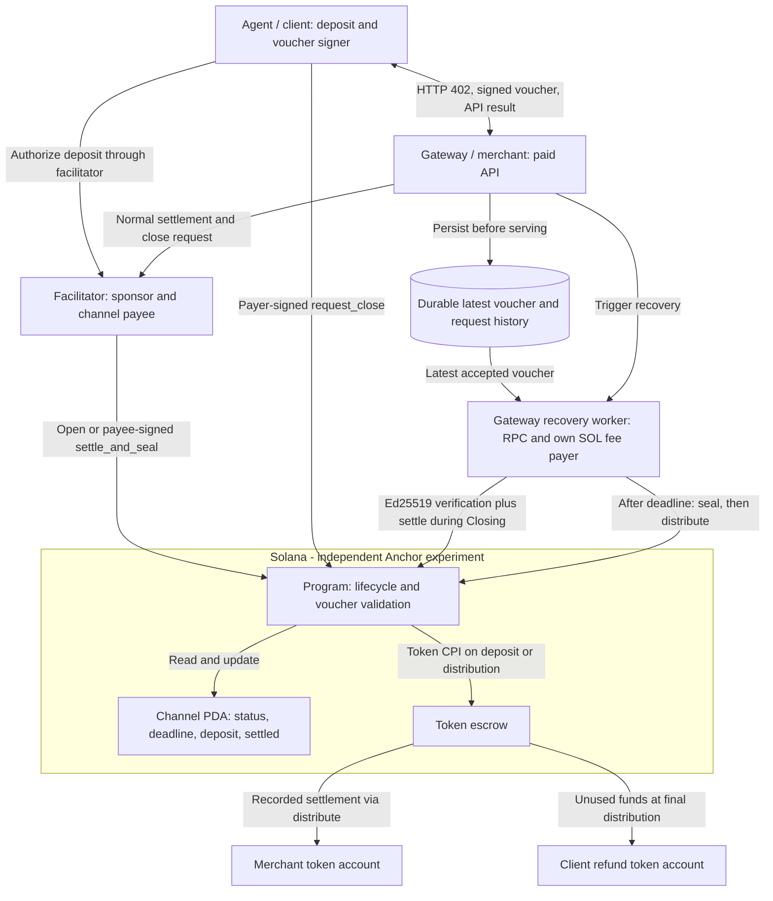
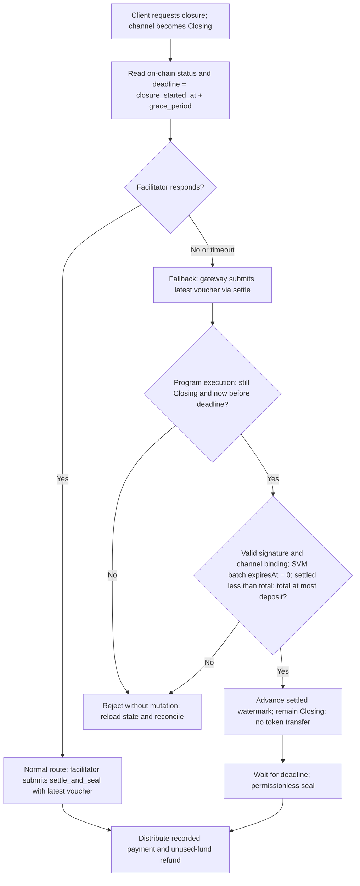

# Closing-period settlement — Issue #90

This focused design belongs to the [four-scheme project](../../ARCHITECTURE.md). See the [slides](slides.md) and [speaker script](script.md). The [auth-capture track](../auth-capture/ARCHITECTURE.md) is a separate presentation option.

## Design focus: Issue #90 (planned)

The proposed experiment gives the merchant a direct settlement route when the facilitator is unavailable during a channel's Closing grace period. It compares an upstream-compatible state gate with a modified gate in our independent Anchor implementation; it does not modify the canonical deployment. The diagrams describe our intended experiment, not implemented behavior.

### Evidence and baseline

Upstream program baseline: `solana-foundation/payment-channels@3ffa4d6728ad88e4a9667a76ad9ccd68a302c696`. Issue text can change; recheck related PRs and the selected code before implementation.

| Claim | Primary evidence |
| --- | --- |
| Normal `settle` currently rejects every state other than Open. It verifies a voucher and advances the settled watermark, without transferring tokens. | [Baseline settle.rs](https://github.com/solana-foundation/payment-channels/blob/3ffa4d6728ad88e4a9667a76ad9ccd68a302c696/program/payment_channels/src/instructions/settle.rs) |
| `settle_and_seal` can handle Closing before its deadline, but requires the channel payee's signature. | [Baseline settle_and_seal.rs](https://github.com/solana-foundation/payment-channels/blob/3ffa4d6728ad88e4a9667a76ad9ccd68a302c696/program/payment_channels/src/instructions/settle_and_seal.rs) |
| In the motivating batch-settlement arrangement, the facilitator holds that payee role, leaving the merchant dependent on it during Closing. | [Issue #90: context and proposal](https://github.com/solana-foundation/payment-channels/issues/90) |
| Distribution pays recorded settlement; sealing and final distribution also support returning unused funds. | [Baseline lifecycle and instructions](https://github.com/solana-foundation/payment-channels/blob/3ffa4d6728ad88e4a9667a76ad9ccd68a302c696/README.md#instructions) |

### Actors and transaction routes

For this experiment, use client-signed vouchers and keep the merchant and facilitator as separate roles and keys, even if both initially run locally. A shared process would hide the outage we want to demonstrate. The gateway needs an independent RPC connection and a SOL-funded transaction fee payer for its fallback route. These are project design choices.

| Actor | Owns / authorizes | Role in the experiment |
| --- | --- | --- |
| Agent / client | Deposit, client voucher key, payer close request | Pays for API requests, then requests channel closure. |
| Gateway / merchant | API service, latest accepted voucher, independent transaction fee payer | Preserves payment evidence and submits direct settlement when necessary. It cannot forge the client's voucher. |
| Facilitator | Sponsor key; channel payee lifecycle authority | Normally sponsors transactions and submits cooperative settlement/closure. Its outage is injected for the comparison. |
| Solana program | Channel state and escrow authority | Enforces lifecycle, signature, channel binding, and amount checks; records settlement separately from distribution. |

### Proposed account and instruction contract

The independent Anchor experiment will use this **logical** single-recipient schema. It follows the canonical [channel fields](https://github.com/solana-foundation/payment-channels/blob/main/program/payment_channels/src/state/channel.rs) and [SVM batch binding](https://github.com/x402-foundation/x402/blob/main/specs/schemes/batch-settlement/scheme_batch_settlement_svm.md) where the experiment needs to reproduce their behavior; this table is not a claim that our account bytes or program ID match the canonical deployment.

| Account / state | Proposed fields or authority | Why it exists |
| --- | --- | --- |
| Channel PDA | Version and bump; payer; payee = facilitator; authorized signer = client voucher key; merchant recipient; refund destination; mint and token program; deposit; settled; payout watermark; status; `closure_started_at`; `grace_period`; channel nonce | Binds the voucher to one channel and records the Closing deadline and cumulative claim. Use a versioned PDA seed domain including payer, payee, mint, signer, and nonce; the exact serialized layout is still to be fixed. |
| Escrow token account | Selected mint and token program; channel PDA is token authority | Holds the deposit. Direct `settle` never transfers from it. |
| Merchant and payer token accounts | Fixed recipient and refund destinations, checked against the channel's mint/program | Receive the settled claim and unused deposit at final distribution. |
| Merchant gateway store | Latest accepted client-signed voucher, accepted request ID and amount, channel ID, transaction status | Durable off-chain evidence for recovery. A voucher is not a separate Solana account. |

| Step / transaction | Signer and instruction order | Effect |
| --- | --- | --- |
| Open and fund | Payer signs `open`; program creates channel/escrow and transfers deposit atomically | `Open`, `deposit = D`, `settled = 0`. Facilitator may sponsor fees and holds payee authority. |
| Paid request | Client sends a cumulative voucher with `expiresAt = 0`; gateway verifies and durably accepts it before serving | No on-chain instruction per request. |
| Request close | Payer signs `request_close` | `Open → Closing`, records `closure_started_at`; no token movement. |
| #90 fallback | Independent fee payer submits an Ed25519 verification instruction immediately followed by `settle` | While `Closing` and before the deadline, checks the verified voucher and advances `settled` only. A failed instruction leaves state unchanged. |
| Finalize | After the deadline, any fee payer submits `seal`, then `distribute` | `Closing → Sealed → Distributed`; the one-recipient example pays `V` to merchant and returns `D − V` to payer, assuming no earlier distribution or token fees. |

The fallback transaction signer need not be the channel payee or voucher signer. The voucher's Ed25519 signature supplies payment authority; the worker pays SOL network fees. The program checks the actual on-chain clock and `settled < V <= deposit`. The open-channel route and payee-signed `settle_and_seal` remain available. Exact account constraints, PDA byte seeds, and instruction serialization are implementation decisions to freeze before coding.

The direct Closing `settle` edge is the #90 change. The recovery worker holds the evidence and submits it; the program decides whether it is valid. Arrows to token accounts show effects of the program's distribution path, not unrestricted transfers by the worker. Permissionless submission still requires a valid authorized-signer voucher and a transaction fee payer. The actor split is based on [Issue #90](https://github.com/solana-foundation/payment-channels/issues/90); settlement and distribution remain separate as in the baseline sources above.

### Closing-period recovery flow

This shows the Closing-specific path. Open still permits normal settlement; Sealed/Distributed do not. The program must check time at execution, not trust the worker's earlier check. A timeout can mean the facilitator's transaction already landed, so the worker reloads chain state and reconciles transaction status before retries. If sealing wins the race, the direct route cannot restore an unrecorded voucher. Successful `settle` records the claim; the worker still needs to complete distribution. This is an improvement in recovery options, not a guarantee against every outage or early cooperative seal. The state gate and unchanged early-seal authority follow [the #90 proposal](https://github.com/solana-foundation/payment-channels/issues/90).

### Demonstration and acceptance criteria

Run the same scenario against baseline and modified behavior: fund a channel, serve paid requests to the shared fictional `/api/trump-insider` resource, retain the latest client voucher, request closure, and stop the facilitator before final settlement. The API response is the same parody used by the `exact` demo; the voucher and Closing behavior are the experiment. Under the baseline the merchant's Closing `settle` fails; under the modified gate it records the authorized amount before the deadline. After sealing and distribution, assert the merchant's payment and client refund balances.

- Accept a valid voucher in Open and in Closing strictly before the deadline; reject at the deadline and afterward, and in Sealed/Distributed.
- Preserve signature, channel identity, monotonic amount, deposit cap, and checked-arithmetic checks. Require `expiresAt = 0` for the SVM batch binding; retain the underlying voucher verifier's expiry semantics for any other format. Reject invalid requests without partial state changes.
- Keep Closing and its original deadline after direct settlement; do not extend the grace period.
- Verify `settle` alone changes no token balances; verify distribution pays once and returns only the eligible remainder.
- Exercise gateway restart, transaction timeout, a stale/duplicate voucher, and sealing before the fallback transaction lands.

These are proposed tests, not completed results. The main learning scope is lifecycle and recovery testing, with no new voucher format or cryptographic algorithm. The earlier channel sketches in the [shared architecture](../../ARCHITECTURE.md) combine delta transfer and settlement; **the #90 experiment instead uses the separate settle/distribute model described here**. Its diagrams and role table are authoritative for this focused experiment; a matching serialized account schema remains to be implemented.
