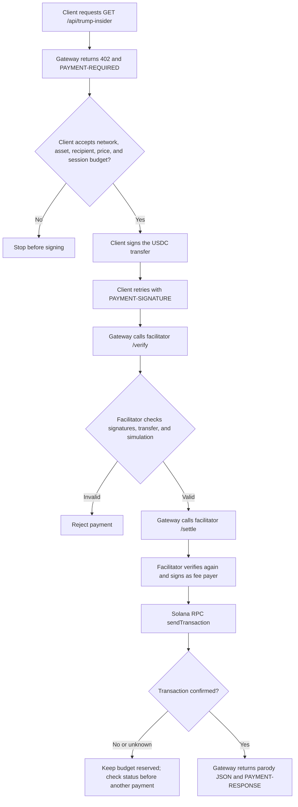
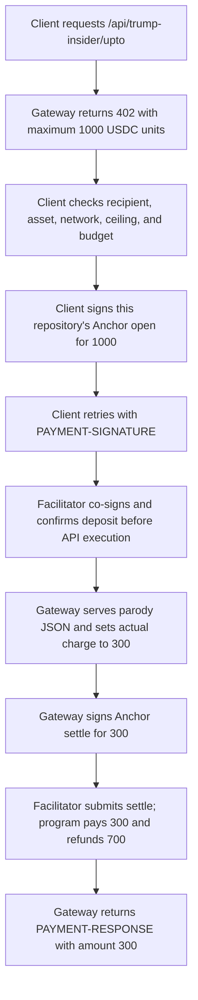

# x402 payment gateway

This package runs the gateway and local facilitator for `exact`, `upto`, opt-in `batch-settlement`, and an experimental opt-in `auth-capture` escrow route. The `upto` and `auth-capture` routes use this repository's Anchor program; batch settlement uses the official SVM SDK and Solana Foundation payment-channels program. The separate [payment client](../client/README.md) makes requests and enforces spending limits. Each route charges or authorizes up to 0.001 devnet USDC. The paid response is an explicitly fictional Donald Trump "insider information" parody, not a source of non-public information.

The parody response lives in [`src/demo-resource.ts`](src/demo-resource.ts), separate from the payment middleware. All four routes serve the same response. The proposed Anchor Closing recovery experiment remains planned.

## Experimental auth-capture escrow flow

This is the [Demo Day focus](../../docs/topics/auth-capture/slides.md); the [runbook](../../docs/topics/auth-capture/demo.md) gives a timed walkthrough and labels local versus Devnet evidence.

Set `AUTH_CAPTURE_ENABLED=1` in the gateway and facilitator environment after deploying the current Anchor program. Set `AUTH_CAPTURE_MERCHANT_KEYPAIR_FILE` to the merchant key matching `GATEWAY_PAY_TO`; the same merchant key is needed for later refunds. The client selects `PAYMENT_SCHEME=auth-capture` or `AGENT_SCHEMES=auth-capture`. The route is `GET /api/trump-insider/auth-capture`.

The 402 quote advertises a 1000-unit ceiling, the experimental binding ID, the program ID, and absolute capture/refund deadlines. The payer signs `authorize_hold` for 1000 atomic Devnet USDC units. The facilitator verifies and confirms the hold before the API handler runs. After the handler, the merchant signs `capture_and_void_hold` for the illustrative 300-unit charge; the program pays 300 to the merchant and releases 700 to the payer in one transaction. The facilitator confirms that transaction before the gateway returns the paid response. A model only selects the tool; application code checks the quote and budget.

The payment PDA persists with counters and a one-use operation sequence. The payer can submit `reclaim_hold` directly after the capture deadline if a hold remains. Merchant-funded `refund_captured` and other lifecycle operations use the [client operation CLI](../client/README.md#auth-capture-operations); a refund does not draw from the hold vault. The demo uses classic SPL token accounts, associated token addresses, and zero protocol fees.

This is an **experimental escrow-only SVM binding**, not an official interoperable x402 Solana auth-capture binding. The generic specification's direct `authorization → charge` path is not implemented, and later lifecycle calls are direct transactions rather than facilitator `/settle` calls. Local HTTP tests use simulated RPC; LiteSVM tests execute the Anchor program. Live Devnet balances remain unverified. The Issue #90 batch Closing proposal is unrelated to this route.

## Batch-settlement payment flow

Enable `BATCH_ENABLED=1` in the gateway `.env` and set `BATCH_RECEIVER_KEYPAIR_FILE` to a receiver-authorizer key. The local facilitator needs a funded SOL fee payer, and the client needs devnet USDC for the channel deposit. Start the facilitator before the gateway. The route is `GET /api/trump-insider/batch`; it quotes 1000 atomic USDC units per request. The client opens a channel with the configured deposit on its first call, then signs increasing cumulative vouchers for later calls. A successful HTTP `PAYMENT-RESPONSE` records an accepted voucher commitment. Its empty `transaction` is expected: token distribution happens when the gateway's `BatchChannelManager` claims vouchers and distributes the confirmed delta. The worker runs every `BATCH_REDEEM_INTERVAL_SECONDS` (default 30), and logs confirmed claim and distribution signatures.

Gateway channel state, facilitator receiver bindings, and pending transaction signatures are stored in three `.batch-*.json` files by default. Keep these files on persistent storage, private to the service process, and use only one gateway and one facilitator process per set of files. File writes are atomic and serialized within one process; they do not provide distributed locking. Pending records remain until reconciliation. Do not delete a pending file after a timeout. `BATCH_RPC_URL` selects the worker's confirmed-state RPC; `FACILITATOR_RPC_URL` selects the facilitator's RPC. The receiver-authorizer key is bound at channel open and must stay available for cooperative close or sealing. To return unused escrow, run the [client's batch refund command](../client/README.md#close-a-batch-channel).

This path uses the SDK's official program and wire format. It does not add batch instructions to this repository's Anchor program or implement the proposed Issue #90 direct merchant claim during Closing. Live devnet transfers have not been verified in this repository.

For the roles, connections, and request sequences across the client, gateway, facilitator, and Solana, see the [demo payment architecture](../../docs/demo-payment-architecture.md).

## Exact payment flow



The facilitator pays the network fee; the client authorizes the token transfer. This `exact` path does not call the repository's Anchor program. The automated integration test follows the same flow through the official facilitator SDK, with a local RPC double in place of devnet.

## Upto payment flow



The `/api/trump-insider/upto` route advertises `scheme: "upto"`. The client signs `open` for 1000 units, the facilitator sponsors and confirms that deposit, the gateway serves the report and signs `settle` for 300 units, and the facilitator confirms settlement. The Anchor program sends 700 unused units back to the payer and closes the channel. After expiry, a payer can call `refund` directly if settlement did not happen. The 300-unit charge is a fixed illustrative usage result, not a live usage meter.

To enable it, deploy the Anchor program ID declared in `Anchor.toml` to the configured devnet RPC. Set `UPTO_ENABLED=1` for the local facilitator; it checks that the program is executable at startup. Set `UPTO_MERCHANT_KEYPAIR_FILE` (or `UPTO_MERCHANT_SECRET_KEY`) for the gateway; this key must match `GATEWAY_PAY_TO`. Set `UPTO_RPC_URL` if the gateway uses a different RPC URL. The client selects `PAYMENT_SCHEME=upto` or `AGENT_SCHEMES=upto`. After expiry, the payer can use the [refund CLI](../client/README.md#recover-an-expired-upto-deposit) without the gateway or facilitator. Only classic SPL token accounts are supported. The local integration test uses a simulated RPC and does not prove a devnet transfer.

The official [SVM upto binding](https://github.com/x402-foundation/x402/blob/main/specs/schemes/upto/scheme_upto_svm.md) fixes the Solana Foundation payment-channels program ID and its instruction format. This repository's Anchor program has a different ID and wire format. The demo therefore uses the generic `upto` scheme name and x402 HTTP envelope, but its Solana payment payload is **not interoperable with the official SVM `upto` binding**. A client or facilitator must support this repository's binding to pay this route.

From the repository root:

```sh
npm ci
cp examples/gateway/.env.example examples/gateway/.env
cp examples/client/.env.example examples/client/.env
```

Set the same `GATEWAY_PAY_TO` receiving address in both `.env` files. Set `FACILITATOR_KEYPAIR_FILE` in the gateway `.env` to a devnet keypair with SOL for fees, and `PAYMENT_CLIENT_KEYPAIR_FILE` in the client `.env` to a different devnet keypair with USDC. The receiving address needs a devnet USDC associated token account. Use absolute paths and keep keypair files outside the repository. Base58 secrets can be supplied with `FACILITATOR_SECRET_KEY` and `PAYMENT_CLIENT_SECRET_KEY` instead. The default client cap is 1000 atomic USDC units (0.001 USDC). The facilitator is bound to localhost and accepts only this merchant, asset, amount, and network.

For the demo, run this repository's local facilitator for all enabled routes. It accepts only the configured merchant and asset. The public facilitator is not part of the demo.

In three separate terminals, from the repository root:

```sh
npm run facilitator:env --workspace @anchoring-payment-channels/gateway
npm run dev:env --workspace @anchoring-payment-channels/gateway
npm run pay:env --workspace @anchoring-payment-channels/client
```

The first request receives `402` and payment requirements. The client checks them, signs the selected payment, and retries with `PAYMENT-SIGNATURE`. Batch may perform one corrective 402 resynchronization. The client requires a successful `PAYMENT-RESPONSE` before reporting the authorization or confirmed transfer.

By default, `pay:env` makes one `exact` request with a 1000 atomic USDC unit per-payment and total cap. To use `upto`, deploy the repository program, configure `UPTO_ENABLED=1` and `UPTO_MERCHANT_KEYPAIR_FILE` in the gateway `.env`, then set `PAYMENT_SCHEME=upto` in the client `.env`. To use `auth-capture`, deploy the repository program, configure `AUTH_CAPTURE_ENABLED=1` and `AUTH_CAPTURE_MERCHANT_KEYPAIR_FILE` in the gateway `.env`, then set `PAYMENT_SCHEME=auth-capture` in the client `.env`. To use batch settlement, configure `BATCH_ENABLED=1` and `BATCH_RECEIVER_KEYPAIR_FILE` in the gateway `.env`, then set `PAYMENT_SCHEME=batch-settlement` in the client `.env`. To demonstrate several calls in one run, set `AGENT_REQUEST_COUNT=3`, `AGENT_MAX_PAYMENTS=3`, and `AGENT_MAX_TOTAL_AMOUNT=3000` in the client `.env`. `PAYMENT_MAX_AMOUNT` is the per-payment ceiling. The client session budget reserves each quoted ceiling before signing, counts confirmed charges or accepted vouchers, and counts attempts toward `AGENT_MAX_PAYMENTS`. It rejects a different asset rather than adding unlike token amounts.

If a signed paid request has no confirmed result, the session keeps its amount reserved and stops further payments. It never creates a fresh payment automatically. The per-run budget exists only during this process; batch channel allocations and pending SDK state are stored in `BATCH_CLIENT_STORE_FILE` across restarts. Check the facilitator and Solana transaction history before another run when the outcome is unknown. Running the CLI again can create another charge.

Run local checks:

```sh
npm run payment:check
npm run payment:test
```

The integration tests start separate gateway and facilitator HTTP servers in the same test process, plus a simulated Solana RPC server. For `exact`, the local facilitator verifies the signed payment, adds its signature, calls RPC `sendTransaction`, and checks confirmation. For `upto`, the local facilitator verifies and submits this program's `open` and `settle` transactions; the test checks their program IDs and the 300-unit charge. Batch tests cover the HTTP challenge, facilitator forwarding, and durable store behavior; they do not execute a full batch deposit and payout. The simulated RPC records transactions but does not execute the on-chain program or transfer funds. A separate LiteSVM test verifies the repository's `upto` balances and refund behavior.

For a model-driven demo, configure a local Ollama model and run the [client agent](../client/AGENT.md). It exposes only enabled scheme tools to the model; each tool still checks the gateway's 402 quote and the local spending budget before signing.
