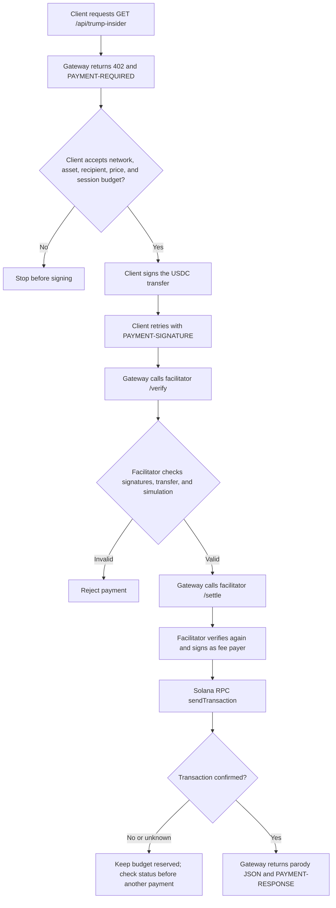
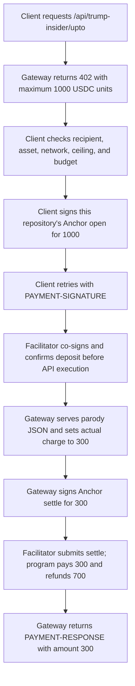

# x402 payment gateway

This package runs the gateway and local facilitator for `exact` and `upto`. The `upto` route uses this repository's Anchor program; the examples use x402 SDKs for HTTP protocol handling and `exact` transfers. The separate [payment client](../client/README.md) makes requests and enforces spending limits. Each route charges or authorizes up to 0.001 devnet USDC. The paid response is an explicitly fictional Donald Trump "insider information" parody, not a source of non-public information.

The parody response lives in [`src/demo-resource.ts`](src/demo-resource.ts), separate from the payment middleware. Both routes serve the same response. `batch-settlement` and `auth-capture` remain planned.

For the roles, connections, and request sequences across the client, gateway, facilitator, and Solana, see the [demo payment architecture](../../docs/demo-payment-architecture.md).

## Exact payment flow



The facilitator pays the network fee; the client authorizes the token transfer. This `exact` path does not call the repository's Anchor program. The automated integration test follows the same flow through the official facilitator SDK, with a local RPC double in place of devnet.

## Upto payment flow



The `/api/trump-insider/upto` route advertises `scheme: "upto"`. The client signs `open` for 1000 units, the facilitator sponsors and confirms that deposit, the gateway serves the report and signs `settle` for 300 units, and the facilitator confirms settlement. The Anchor program sends 700 unused units back to the payer and closes the channel. After expiry, a payer can call `refund` directly if settlement did not happen. The 300-unit charge is a fixed illustrative usage result, not a live usage meter.

To enable it, deploy the Anchor program ID declared in `Anchor.toml` to the configured devnet RPC. Set `UPTO_ENABLED=1` for the local facilitator; it checks that the program is executable at startup. Set `UPTO_MERCHANT_KEYPAIR_FILE` (or `UPTO_MERCHANT_SECRET_KEY`) for the gateway; this key must match `GATEWAY_PAY_TO`. Set `UPTO_RPC_URL` if the gateway uses a different RPC URL. The client selects `PAYMENT_SCHEME=upto` or `AGENT_SCHEMES=upto`. After expiry, the payer can use the [refund CLI](../client/README.md#recover-an-expired-upto-deposit) without the gateway or facilitator. Only classic SPL token accounts are supported. The local integration test uses a simulated RPC and does not prove a devnet transfer.

The official [SVM upto binding](https://github.com/x402-foundation/x402/blob/main/specs/schemes/upto/scheme_upto_svm.md) fixes the Solana Foundation payment-channels program ID and its instruction format. This repository's Anchor program has a different ID and wire format. The demo therefore uses the generic `upto` scheme name and x402 HTTP envelope, but its Solana payment payload is **not interoperable with the official SVM `upto` binding**. A client or facilitator must support this repository's binding to pay this route.

From the repository root:

```sh
npm ci
cp examples/gateway/.env.example examples/gateway/.env
cp examples/client/.env.example examples/client/.env
```

Set the same `GATEWAY_PAY_TO` receiving address in both `.env` files. Set `FACILITATOR_KEYPAIR_FILE` in the gateway `.env` to a devnet keypair with SOL for fees, and `PAYMENT_CLIENT_KEYPAIR_FILE` in the client `.env` to a different devnet keypair with USDC. The receiving address needs a devnet USDC associated token account. Use absolute paths and keep keypair files outside the repository. Base58 secrets can be supplied with `FACILITATOR_SECRET_KEY` and `PAYMENT_CLIENT_SECRET_KEY` instead. The default client cap is 1000 atomic USDC units (0.001 USDC). The facilitator is bound to localhost and accepts only this merchant, asset, amount, and network.

For the demo, run this repository's local facilitator for both routes. It accepts only the configured merchant and asset. The public facilitator is not part of the demo.

In three separate terminals, from the repository root:

```sh
npm run facilitator:env --workspace @anchoring-payment-channels/gateway
npm run dev:env --workspace @anchoring-payment-channels/gateway
npm run pay:env --workspace @anchoring-payment-channels/client
```

The first request receives `402` and payment requirements. The client checks them, signs the selected payment through the official SDK, retries once with `PAYMENT-SIGNATURE`, then requires a successful `PAYMENT-RESPONSE` before reporting success.

By default, `pay:env` makes one `exact` request with a 1000 atomic USDC unit per-payment and total cap. To use `upto`, deploy the repository program, configure `UPTO_ENABLED=1` and `UPTO_MERCHANT_KEYPAIR_FILE` in the gateway `.env`, then set `PAYMENT_SCHEME=upto` in the client `.env`. The latter selects the `/upto` route automatically. To demonstrate several calls in one run, set `AGENT_REQUEST_COUNT=3`, `AGENT_MAX_PAYMENTS=3`, and `AGENT_MAX_TOTAL_AMOUNT=3000` in the client `.env`. `PAYMENT_MAX_AMOUNT` is the per-payment ceiling. The client session budget reserves each quoted ceiling before signing, charges only the confirmed actual amount, and counts attempts toward `AGENT_MAX_PAYMENTS`. It rejects a different asset rather than adding unlike token amounts.

If a signed paid request has no confirmed result, the session keeps its amount reserved and stops further payments. It never creates a fresh payment automatically. The budget and pending state exist only during this process; they are not durable across CLI restarts. Check the facilitator and Solana transaction history before another run when the outcome is unknown. Running the CLI again can create another charge.

Run local checks:

```sh
npm run payment:check
npm run payment:test
```

The integration tests start separate gateway and facilitator HTTP servers in the same test process, plus a simulated Solana RPC server. For `exact`, the local facilitator verifies the signed payment, adds its signature, calls RPC `sendTransaction`, and checks confirmation. For `upto`, the local facilitator verifies and submits this program's `open` and `settle` transactions; the test checks their program IDs and the 300-unit charge. The simulated RPC records transactions but does not execute the on-chain program or transfer funds. A separate LiteSVM test verifies on-chain balances and refund behavior.

For a model-driven demo, configure a local Ollama model and run the [client agent](../client/AGENT.md). It exposes only enabled scheme tools to the model; each tool still checks the gateway's 402 quote and the local spending budget before signing.
